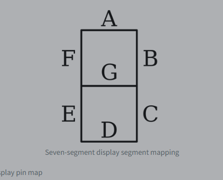
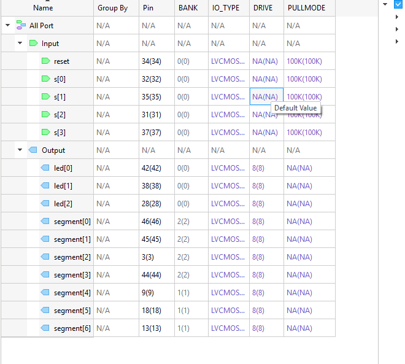
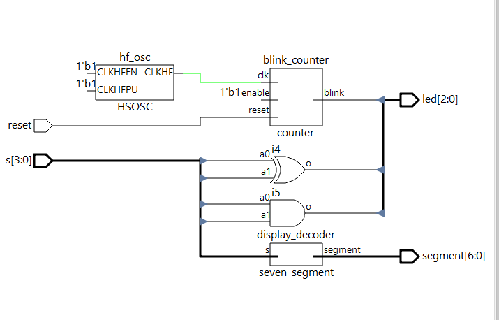
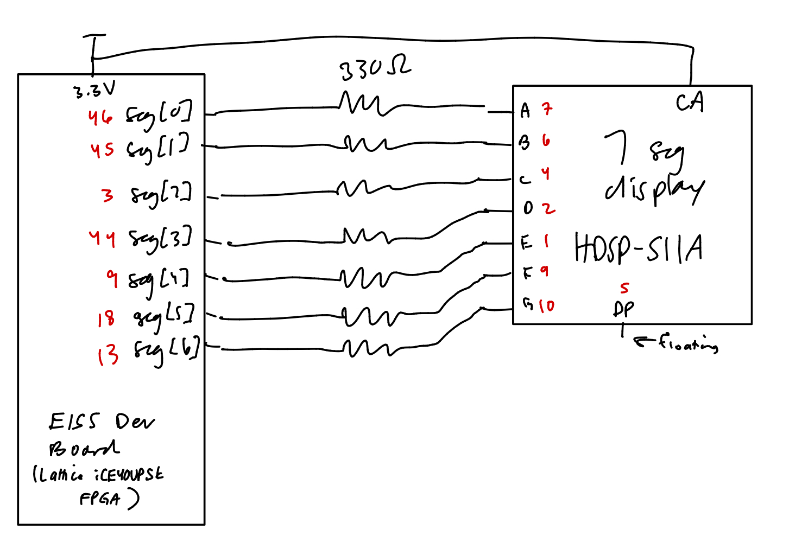
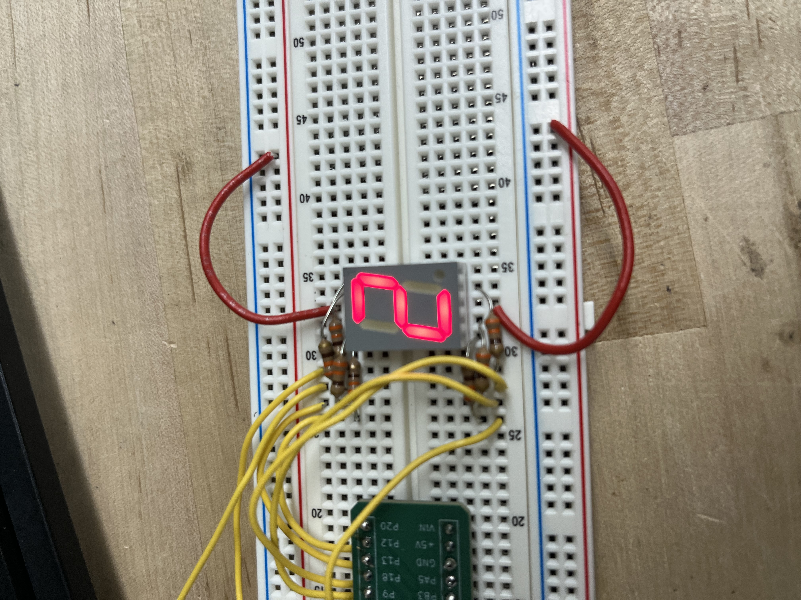
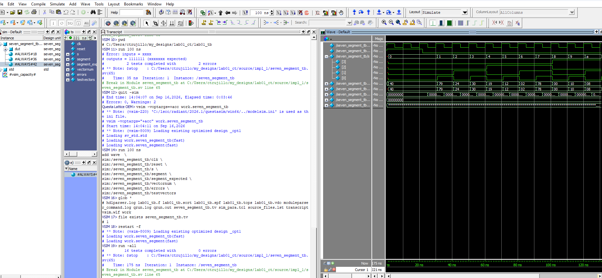

# Introduction

In this lab, I assembled and tested the E155 development board, wrote Verilog code to control LEDS and designed a 7-segment display driver on the UPduino FPGA. The goal is to create a module that can take a 4-bit binary input from the DIP switches and display the corresponding hexadecimal digit (0-9 and A-F) on a seven-segment display. I also implemented a counter that increments the input value every second, allowing me to observe the output on the display. Then I simulated my design in QuestaSim, programmed the FPGA with it, and tested on the physical hardware.

# Design and Testing Methodology

## Overall Design

I organized the design into separate modules for the counter and the seven segment display and the top level logic. the top level module connects x y z.

- [`lab01_ct.sv`](#lab01_ct-sv): top level module, connects everything
- [`seven_segment.sv`](#seven_segment-sv): goes from switch input s[3:0] to segment display output segment[6:0]
- [`counter.sv`](#counter-sv): generates blinking signal

I created a testbench ([`seven_segment_tb.sv`](#seven_segment_tb-sv)), driven by test vectors in [`seven_segment.tv`](#seven_segment-tv), for the seven segment display to verify that the output segments correspond correctly to the 4-bit binary input.

## Seven-Segment Decoder
{width=100%}

I mapped the 4 switch inputs to the corresponding segments of the seven-segment display. The mapping is as follows: segment[6:0] = {a, b, c, d, e, f, g}, where each letter corresponds to a segment of the display. This is implemented with a case statement in [`seven_segment.sv`](#seven_segment-sv). The truth table for the seven-segment decoder is as follows:

| Switch Input (s[3:0]) | Segment Output (segment[6:0]) |
|------------------------|-------------------------------|
| 0                      | 1 1 1 1 1 1 0                 |
| 1                      | 0 1 1 0 0 0 0                 |
| 2                      | 1 1 0 1 1 0 1                 |
| 3                      | 1 1 1 1 0 0 1                 |
| 4                      | 0 1 1 0 0 1 1                 |
|5                      | 1 0 1 1 0 1 1                 |
|6                      | 1 0 1 1 1 1 1                 |
|7                      | 1 1 1 0 0 0 0                 |
|8                      | 1 1 1 1 1 1 1                 |
|9                      | 1 1 1 1 0 1 1                 |
|A                      | 1 1 1 0 1 1 1                 |
|b                      | 1 1 1 1 1 1 1                 |
|C                      | 1 0 0 1 1 1 0                 |
|d                      | 1 1 1 1 0 1 1                 |
|E                      | 1 0 0 1 1 1 1                 |
|F                      | 1 0 0 0 1 1 1                 |

## LED Logic

i made the leds to correspond with the 4 switch inputs so that led[0] is an xor gate of s[0] and s[1], and led[1] is an and gate of s[2] and s[3]. These are implemented as `assign` statements in [`lab01_ct.sv`](#lab01_ct-sv).

## Counter and Clock Divider

The fpga is at  48 hz, we want led[2] to blink at 2.4 hz. T = 1/2.4 = 0.4167 seconds. 0.4167/2 = 0.2083 seconds. N = 48*10^6 * 0.2083 = 10000000. The clock divider will divide the 48 Hz clock by 20 to achieve a 2.4 Hz blinking frequency for led[2]. The counter increments the input value every second, allowing us to observe the output on the display. This is implemented in [`counter.sv`](#counter-sv).

## Testing Methodology

i made a testbench ([`seven_segment_tb.sv`](#seven_segment_tb-sv)) for the seven segment display to verify that the output segments correspond correctly to the 4-bit binary input, using the test vectors in [`seven_segment.tv`](#seven_segment-tv).

# Technical Documentation

## Verilog Source Code

<details id="lab01_ct-sv">
<summary>lab01_ct.sv: top level module, connects everything</summary>
````{.systemverilog}
module lab01_ct(
    input  logic       reset,
    input  logic [3:0] s,
    output logic [2:0] led,
    output logic [6:0] segment
);

    logic int_osc;

    // instatiate the fpga's internal oscillator 
    HSOSC #(.CLKHF_DIV(2'b01))
        hf_osc (
            .CLKHFPU(1'b1),
            .CLKHFEN(1'b1),
            .CLKHF(int_osc)
        );

    assign led[0] = s[1] ^ s[0]; // on when exactly one of switches 0 and 1 is on
    assign led[1] = s[2] & s[3]; // on when exactly both switches 2 and 3 are on

    counter #(
        .MAX_COUNT(10_000_000)
    ) blink_counter (
        .clk(int_osc),
        .reset(reset),
        .enable(1'b1),
        .blink(led[2])
    );

    // decoder
    seven_segment display_decoder (
        .s(s),
        .segment(segment)
    );

endmodule
````
</details>

<details id="counter-sv">
<summary>counter.sv: generates blinking signal</summary>
````{.systemverilog}
module counter #(
    parameter int unsigned MAX_COUNT = 10_000_000
)(
    input  logic clk,
    input  logic reset,
    input  logic enable,
    output logic blink
);

    localparam int COUNT_WIDTH = $clog2(MAX_COUNT);

    logic [COUNT_WIDTH-1:0] count; // count to 9999999

    always_ff @(posedge clk, negedge reset) begin
        if (!reset) begin
            count <= 0;
            blink <= 0;
        end
        else if (enable) begin
            if (count == MAX_COUNT - 1) begin
                count <= 0;
                blink <= ~blink; // toggle led
            end
            else begin
                count <= count + 1;
            end
        end
    end

endmodule
````
</details>

<details id="seven_segment-sv">
<summary>seven_segment.sv: goes from switch input s[3:0] to segment display output segment[6:0]</summary>
````{.systemverilog}
module seven_segment(
    input  logic [3:0] s,
    output logic [6:0] segment
);

    always_comb begin
        case (s)
            4'h0: segment = 7'b1000000;
            4'h1: segment = 7'b1111001;
            4'h2: segment = 7'b0100100;
            4'h3: segment = 7'b0110000;
            4'h4: segment = 7'b0011001;
            4'h5: segment = 7'b0010010;
            4'h6: segment = 7'b0000010;
            4'h7: segment = 7'b1111000;
            4'h8: segment = 7'b0000000;
            4'h9: segment = 7'b0010000;
            4'hA: segment = 7'b0001000;
            4'hB: segment = 7'b0000011;
            4'hC: segment = 7'b1000110;
            4'hD: segment = 7'b0100001;
            4'hE: segment = 7'b0000110;
            4'hF: segment = 7'b0001110;
            default: segment = 7'b1111111;
        endcase
    end

endmodule
````
</details>

<details id="seven_segment_tb-sv">
<summary>seven_segment_tb.sv: testbench for seven segment display</summary>
````{.systemverilog}
module seven_segment_tb();

    logic clk, reset;
    logic [3:0] s;
    logic [6:0] segment, segment_expected;

    logic [31:0] vectornum, errors;
    logic [10:0] testvectors[10000:0];

    seven_segment dut (
        .s(s),
        .segment(segment)
    );

    // clk 10 ns period
    always begin
        clk = 1; #5;
        clk = 0; #5;
    end

    // get tv
    initial begin
        $readmemb("seven_segment_tb.tv", testvectors);

        vectornum = 0;
        errors = 0;

        reset = 1;
        #22;
        reset = 0;
    end

    always @(posedge clk) begin
        #1;
        {s, segment_expected} = testvectors[vectornum];
    end

    always @(negedge clk) begin
        if (~reset) begin

            if (segment !== segment_expected) begin
                $display("Error: inputs = %b", s);
                $display(
                    "outputs = %b (%b expected)",
                    segment,
                    segment_expected
                );

                errors = errors + 1;
            end

            vectornum = vectornum + 1;

            if (testvectors[vectornum] === 11'bx) begin
                $display(
                    "%d tests completed with %d errors",
                    vectornum,
                    errors
                );
                $stop;
            end
        end
    end

endmodule
````
</details>

<details id="seven_segment-tv">
<summary>seven_segment.tv: test vector for seven segment display</summary>
````{.text}
00001000000
00011111001
00100100100
00110110000
01000011001
01010010010
01100000010
01111111000
10000000000
10010010000
10100001000
10110000011
11001000110
11010100001
11100000110
11110001110
````
</details>

## Pin Assignments

{width=100%}

<details>
<summary>pins.pdc</summary>
````{.tcl}
ldc_set_location -site {34} [get_ports reset]
ldc_set_location -site {32} [get_ports {s[0]}]
ldc_set_location -site {35} [get_ports {s[1]}]
ldc_set_location -site {31} [get_ports {s[2]}]
ldc_set_location -site {37} [get_ports {s[3]}]
ldc_set_location -site {28} [get_ports {led[2]}]
ldc_set_location -site {46} [get_ports {segment[0]}]
ldc_set_location -site {45} [get_ports {segment[1]}]
ldc_set_location -site {3} [get_ports {segment[2]}]
ldc_set_location -site {44} [get_ports {segment[3]}]
ldc_set_location -site {12} [get_ports {segment[4]}]
ldc_set_location -site {18} [get_ports {segment[5]}]
ldc_set_location -site {13} [get_ports {segment[6]}]
ldc_set_location -site {42} [get_ports {led[0]}]
ldc_set_location -site {38} [get_ports {led[1]}]
````
</details>

## Block Diagram

{width=100%}

## Hardware Schematic

{width=100%}

## Current-Limiting Resistor Calculation

Segment current (from AlGaAs Red, HDSP-511A datasheet)
Supply V_CC = 3.3 V. 
Datasheet forward voltage: V_F = 1.85 V typ, 2.00 V max at I_F = 20 mA. 
Absolute max continuous current per segment: 15 mA (at 25°C).

Target I_F = 5 mA: R = (3.3 V − 1.85 V) / 5 mA ≈ 290 Ω, so I chose the next standard value up, 330 Ω.

Actual current: I_F = (3.3 V − 1.85 V) / 330 Ω ≈ 4.4 mA. Using the max V_F of 2.00 V gives ≈ 3.9 mA. 

Far below the 15 mA limit!

## Blink Frequency Calculation

Given: FPGA clock (HSOSC) f_clk = 48 MHz, target blink rate f_LED = 2.4 Hz.

Blink period: T = 1 / 2.4 Hz = 0.4167 s
The LED toggles twice per period, so the half-period is 0.4167 s / 2 = 0.2083 s
Cycles per toggle: N = 48×10⁶ Hz × 0.2083 s ≈ 10,000,000 cycles

To check: f_LED = 48 MHz / (2 × 10,000,000) = 2.4 Hz !

# Simulation Results

## Seven-Segment Decoder Test

{width=100%}

## Counter Test

N/A

## Top-Level Test

N/A

## Seven-Segment Display

{width=100%}

## LED Outputs

I tested all four combinations of s[0] and s[1] and confirmed led[0] only lit up when exactly one of the two was high, matching the XOR truth table. I did the same for s[2] and s[3] against led[1], which only lit up when both were high, matching the AND truth table. Both LEDs matched their expected truth tables for all input combinations.

## Issues and Debugging

{width=100%}

# Requirements Checklist

This design meets all Proficiency specifications and all Excellence specifications, except that I did not write QuestaSim testbenches for the counter module or the top-level module. I only created an automatic testbench for the seven-segment decoder; the counter and top-level behavior were verified on hardware but not simulated.

# Conclusion

Met all proficiency and most excellence specifications. Spent ~15 hours on this lab.

# AI Prototype and Reflection

## AI Prototype

I was able to synthesze the design from Claude but Radiant programmer wasnt working idk. there was one major hiccup and it was cause the original prompt didnt specify that we were using lattice radiant. It took me 6 prompts to get successfuly .sv and .pdc files that synthesized.

Claude used the wrong library for the oscillator primitive, which caused a synthesis error. The  code instantiated an unknown `SB_HFOSC` instead of the Lattice-recognized oscillator `HSOSC`. This was corrected in later prompts.

Also it used the wrong set pin syntax for the .pdc file. it tried to use set_io_location instead of ldc_set_location. This was also corrected in later prompts.

{width=100%}

## Reflection

**How would you rate the quality of the output and why?**

I would say that the quality is decent. the main problem for me is that it used some syntax I wasn't familiar with and had to look up. I do appreciate the diligence of the comments but it does make things feel a little more overwhelming and more complicated than it might actually be. 

**What SystemVerilog constructs/syntax did the LLM generated that were new to you?**

I had never seen int'((real'(...))) before.

**Did the LLM-generated code synthesize the first time around? If not, what were the issues?**
**What error or warning messages did Radiant output?**

No it took 6 prompts.

**What would you do differently the next time you use an LLM in your workflow?**

I would probably give it a lot more context and maybe even examples of the syntax I wanted it to use. I would also try to be more specific about the tools I was using and the requirements of the project.