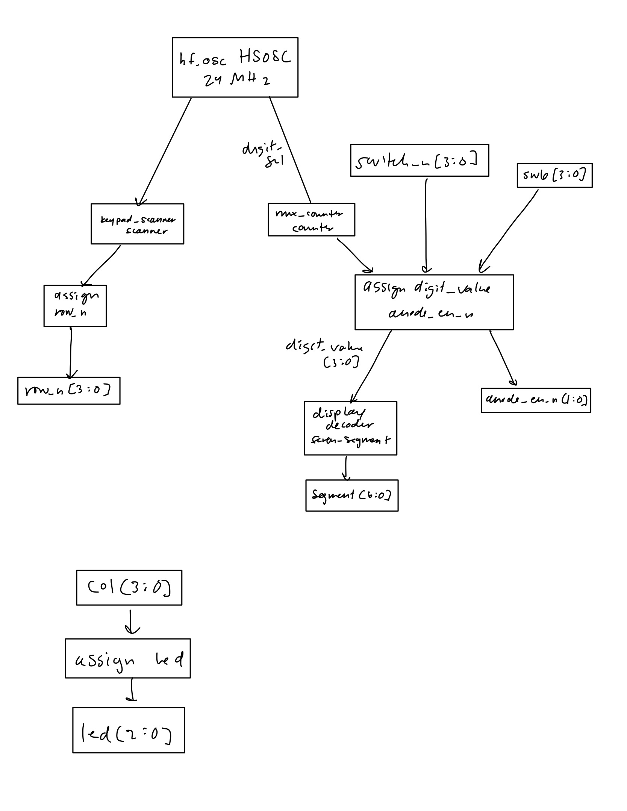
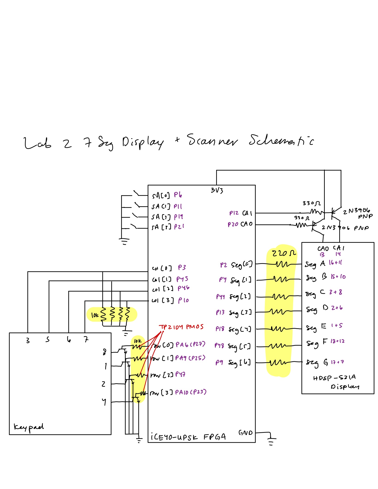
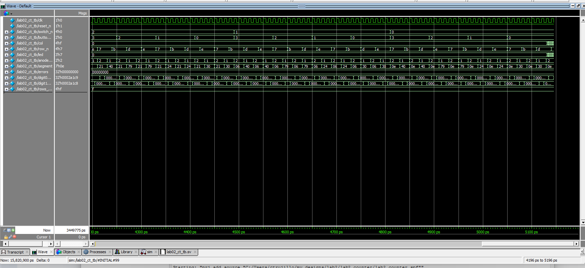

# Introduction

In this lab, I used one seven segment decoder to drive both digits of a dual seven segment display by time multiplexing between them. Each digit's common anode is turned on and off with a transistor, so only one digit is on at a time but it switches fast enough that you can't tell. The right digit shows a 4-bit number from a DIP switch I put on the breadboard and the left digit shows a 2-bit number from pushbuttons SW0 and SW1 on the dev board. I also scanned a 4x4 keypad and hooked columns 1-3 up to LEDs, so when you hold down a key in one of those columns the LED blinks when the scanner gets to that row.

# Design and Testing Methodology

## Overall Design

I organized the design into a top level module, a counter, a scanner and the seven segment decoder from lab 1.

- [`lab02_ct.sv`](#lab02_ct-sv): top level module, connects everything and does the multiplexing and LED logic
- [`counter.sv`](#counter-sv): lab 1 counter, only edit is that count is an output now
- [`scanner.sv`](#scanner-sv): keypad scanner, uses a counter to pick which row is on
- [`seven_segment.sv`](#seven_segment-sv): lab 1 decoder, didn't change it

## Time Multiplexing

The oscillator is 24 MHz, and I wanted each digit on for 1 ms. N = 24×10⁶ × 0.001 = 24,000 cycles. So mux_counter toggles digit_sel every 24,000 cycles. digit_sel picks what goes into the decoder (breadboard DIP switch or the pushbuttons) and which digit gets turned on with left_digit and right_digit (active-low, so 0 = on). Each digit is on 1 ms out of every 2 ms, so the refresh rate is 500 Hz and it doesn't flicker.

The DIP switch and the pushbuttons both connect the pin to ground when they're ON/pressed, so I invert them in the top level. The pushbuttons are only 2 bits, so the top two bits of the left digit are always 0 and it shows 0-3.

## Keypad Scanning

The scanner uses a counter to rotate which row is on: 1000, 0100, 0010, 0001. Each row is on for 0.25 s, so N = 24×10⁶ × 0.25 = 6,000,000 cycles per row, and each row bit toggles at 2 Hz. Each row goes to a TP2104 PMOS that pulls the keypad row up to 3.3 V when that row is on. If you press a key in the row that's on, it pulls its column high, and the top level just copies columns 1-3 to LEDs D6-D8.

## Testing Methodology

I simulated the counter, the scanner and the top level in QuestaSim, each with a self-checking testbench that counts errors, and all three passed with 0 errors (waveforms in [Simulation Results](#simulation-results)).

- **counter_tb:** I re-ran this since I changed the counter to output count. It checks that it counts, wraps, holds while enable is low and resets.
- **scanner_tb:** checks all four row transitions (1000 → 0100 → 0010 → 0001), that the row holds while enable is low, and that reset goes back to 1000.
- **lab02_ct_tb:** checks that only one digit is on at a time, that each digit shows the right segments for every DIP switch value and button combination, that every keypad row gets driven, and that the LEDs follow the columns.

The seven segment decoder didn't change from lab 1, so I didn't re-simulate it ([lab 1 simulation](../lab01/lab1.html#seven-segment-decoder-test)).

# Technical Documentation

## Verilog Source Code

<details id="lab02_ct-sv">
<summary>lab02_ct.sv: top level</summary>
```{.systemverilog}

```
</details>

<details id="counter-sv">
<summary>counter.sv: lab 1 counter with a count output</summary>
```{.systemverilog}

```
</details>

<details id="scanner-sv">
<summary>scanner.sv: keypad row scanner</summary>
```{.systemverilog}

```
</details>

<details id="seven_segment-sv">
<summary>seven_segment.sv: lab 1 decoder (unchanged)</summary>
```{.systemverilog}

```
</details>

<details>
<summary>counter_tb.sv</summary>
```{.systemverilog}

```
</details>

<details>
<summary>scanner_tb.sv</summary>
```{.systemverilog}

```
</details>

<details>
<summary>lab02_ct_tb.sv</summary>
```{.systemverilog}

```
</details>

## Pin Assignments

<details>
<summary>pins.pdc</summary>
```{.tcl}

```
</details>

## Block Diagram

{width=100%}

## Hardware Schematic

{width=100%}

Pushbuttons SW0 (P34) and SW1 (P43), LEDs D6-D8 and SW7 are on the dev board so I didn't draw them, they're in the [development board schematic](https://hmc-e155.github.io/assets/doc/E155%20FA22%20Development%20Board%20Schematic.pdf). The DIP switch and the pushbuttons use the FPGA's internal pull-ups.

## Current Calculations

FPGA max current per pin: 8 mA (iCE40UP5K datasheet, Table 4.13).

Segment pins (HDSP-521A datasheet)
Supply V_CC = 3.3 V.
Datasheet forward voltage: V_F = 2.0 V typ at 20 mA. From Figure 2 it's around 1.8 V at ~6 mA, so for worst case (most current) I used V_F = 1.7 V.
PNP drop: V_EC(sat) = 0.2 V.

I = (3.3 V − 0.2 V − 1.7 V) / 220 Ω ≈ 6.4 mA

Under 8 mA and way under the display's 20 mA max per segment!

Digit enable pins (2N3906 base through 330 Ω)
I = (3.3 V − 0.7 V) / 330 Ω ≈ 7.9 mA

Keypad row pins
These go to the TP2104 gates which basically don't draw current. The dev board LEDs on PA6, PA9 and PA10 add (3.3 V − 2.0 V) / 1 kΩ ≈ 1.3 mA.

LED pins (D6-D8, 1 kΩ on the board)
I ≤ 3.3 V / 1 kΩ = 3.3 mA

Input pins only have the internal pull-up current, which is ≤ 128 µA.

All under 8 mA!

# Simulation Results

The seven segment decoder was already tested in lab 1: [lab 1 decoder simulation](../lab01/lab1.html#seven-segment-decoder-test).

## Counter Test

<details>
<summary>counter_tb waveform</summary>
{width=100%}
</details>

## Scanner Test

<details>
<summary>scanner_tb waveform</summary>
{width=100%}
</details>

## Top-Level Test

<details>
<summary>lab02_ct_tb waveform</summary>
{width=100%}
</details>

# Requirements Checklist

This design meets all Proficiency specifications. Some things I did differently from the lab handout:

- I used 2N3906 PNPs to switch the digits instead of TP2104 PMOS, and used TP2104 PMOS with pull-down resistors for the keypad rows instead of TN2106 NMOS.
- The right digit's 4-bit number comes from a DIP switch on the breadboard instead of SW6 on the dev board, because SW6's switch 4 only made contact when I pressed on the board. The left digit comes from pushbuttons SW0:SW1 like the handout says (SW1 is the LSB since it's on the right physically).
- Keypad column 4 (A-D) doesn't have an LED because I ran out of FPGA pins on the breadboard adapter.

# Conclusion

Met all proficiency specifications. Spent ~21 hours on this lab.

# AI Prototype and Reflection

## AI Prototype


## Reflection

**How would you rate the quality of the output and why?**


**What SystemVerilog constructs/syntax did the LLM generate that were new to you?**


**Did the LLM-generated code synthesize the first time around? If not, what were the issues? What error or warning messages did Radiant output?**


**What would you do differently the next time you use an LLM in your workflow?**


