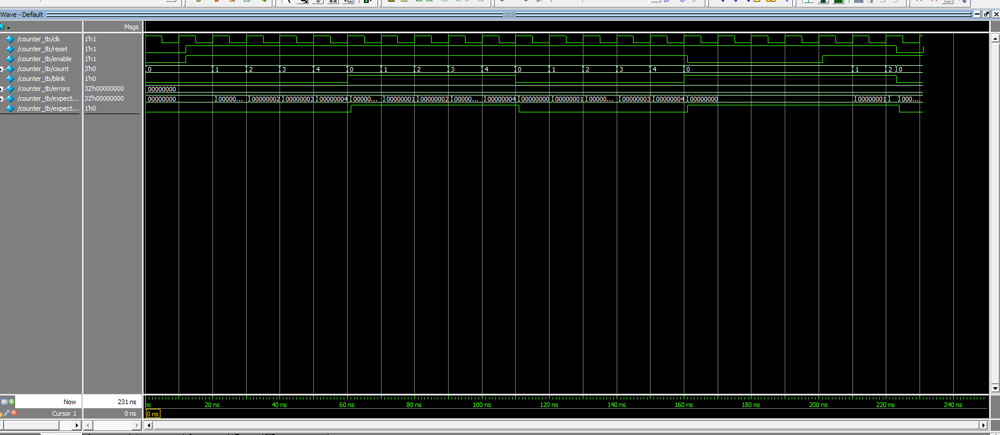
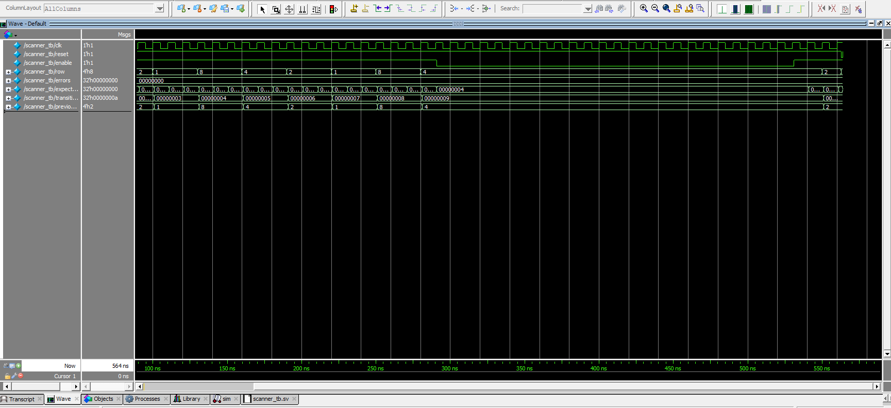

# Introduction

In this lab I drove two seven-segment digits from a single seven-segment decoder by time multiplexing them, switched each digit's common anode with a transistor, and scanned a 4×4 keypad through open-drain row drivers. The first digit shows the 4-bit number on a DIP switch on the breadboard. The second digit shows the 2-bit number on pushbuttons SW1 and SW0, so it ranges from 0 to 3. Keypad columns 2–4 are passed straight through to LEDs, so holding a key in those columns blinks an LED at the scan rate.

# Design and Testing Methodology

## Overall Design

The design uses four modules. The seven-segment decoder is reused unchanged from lab 1, and the counter is the lab 1 counter with one added output port.

- [`lab02_ct.sv`](#lab02_ct-sv): top level. Instances of `HSOSC`, `counter`, `scanner`, and `seven_segment`, plus one-line `assign` statements for multiplexing and LED pass-through.
- [`counter.sv`](#counter-sv): the lab 1 counter. In lab 2 its `count` value is also an output so the scanner can decode it.
- [`scanner.sv`](#scanner-sv): keypad row scanner. A counter instance plus one `assign` that maps the count to a one-hot row.
- [`seven_segment.sv`](#seven_segment-sv): the lab 1 decoder (4-bit value to active-low segments).

```{mermaid}
flowchart LR
    subgraph lab02_ct
        osc["hf_osc : HSOSC\n24 MHz"] -- int_osc --> mux["mux_counter : counter\nMAX_COUNT = 24,000"]
        osc -- int_osc --> scan["keypad_scanner : scanner\nCYCLES_PER_ROW = 6,000,000"]
        mux -- "blink → digit_sel" --> sel{{"assign digit_value\nassign anode_en_n"}}
        sel -- "digit_value[3:0]" --> dec["display_decoder : seven_segment"]
        colin{{"assign led = col[3:1]"}}
        subgraph scanner
            sc["scan_counter : counter\nMAX_COUNT = 24,000,000"] -- "scan_count" --> rowlogic{{"assign row (one-hot)"}}
        end
        scan --- scanner
    end
    sw["switch_n[3:0]"] --> sel
    btn["button_n[1:0]"] --> sel
    rst["reset_n"] --> mux & scan
    sel --> cath["anode_en_n[1:0]"]
    dec --> seg["segment[6:0]"]
    col["col[3:0]"] --> colin --> led["led[2:0]"]
    rowlogic --> rowinv{{"assign row_n = ~row_active"}} --> row["row_n[3:0]"]
```

## Time Multiplexing

`mux_counter` is a lab 1 counter with `MAX_COUNT = 24,000`. Its `blink` output toggles every 24,000 cycles of the 24 MHz oscillator, which is every 1 ms. That signal, `digit_sel`, picks both what the decoder sees and which digit is on:

- `digit_sel = 0`: decoder input is the breadboard DIP switch, `anode_en_n = 10` (digit 0 on).
- `digit_sel = 1`: decoder input is `{2'b00, buttons}`, `anode_en_n = 01` (digit 1 on).

Each digit is lit for 1 ms out of every 2 ms, a 500 Hz refresh. That is far above the roughly 60 Hz where flicker becomes visible. It is also long compared with the transistor switching time (well under a microsecond), so the digits don't bleed into each other.

The DIP switch and pushbuttons connect their pins to ground when ON or pressed, and the FPGA's internal pull-ups hold them high otherwise. The top level inverts them (`~switch_n`, `~button_n`) so that ON or pressed counts as 1.

The display is an HDSP-521A, a common-anode dual-digit display. The lab 1 decoder already drives active-low segments for a common-anode display, so its output goes straight to the segment pins, and the decoder's lab 1 simulation still applies. Each segment line connects to that segment on both digits, so the 7 FPGA pins drive both.

## Keypad Scanning

`scanner` is a non-canonical state machine. A lab 1 counter instance with `MAX_COUNT = 4 × CYCLES_PER_ROW` holds the state, and one `assign` turns the count into a one-hot row:

| `scan_count` | `row` |
|---|---|
| 0 to CYCLES_PER_ROW − 1 | 1000 |
| CYCLES_PER_ROW to 2·CYCLES_PER_ROW − 1 | 0100 |
| 2·CYCLES_PER_ROW to 3·CYCLES_PER_ROW − 1 | 0010 |
| 3·CYCLES_PER_ROW to 4·CYCLES_PER_ROW − 1 | 0001 |

With `CYCLES_PER_ROW = 6,000,000`, each row is active for 0.25 s and the pattern repeats once per second. Each row bit goes high once and low once per second, so it toggles at 2 Hz. `reset` and `enable` are passed through to the counter: reset forces row 1000, and holding `enable` low freezes the current row.

The lab stocks TN2106 NMOS transistors for the rows, but only TP2104 PMOS transistors were available, so the keypad uses the mirror image of the intended circuit. The top level inverts the scanner output into `row_n`, and each `row_n` output drives the gate of a TP2104 whose source is at 3.3 V and whose drain is a keypad row. When `row_n[i] = 0`, the PMOS turns on and pulls keypad row i up to 3.3 V. When `row_n[i] = 1`, the PMOS is off and a 10 kΩ pull-down holds the row at ground. The FPGA never drives a row low directly, so two pressed keys in the same column can't short an active row to a driven-low row. It's the same protection as an open-drain NMOS, just mirrored.

Each column has a 10 kΩ pull-down to ground. That overpowers the FPGA's weak internal pull-up (about 100 kΩ), so an idle column reads 0. A pressed key in the active row pulls its column up to 3.3 V through the PMOS, and `led = col[3:1]` turns the matching LED on. Column 1 has no LED, because every FPGA pin the breadboard adapter can reach was already in use. Holding a key blinks its column's LED on for 0.25 s every second.

## Testing Methodology

The decoder is unchanged from lab 1, so I did not re-simulate it. Its lab 1 testbench and waveforms are linked in [Simulation Results](#simulation-results). I wrote one automatic, self-checking testbench for each module that is new or changed:

- [`counter_tb.sv`](#counter_tb-sv) re-verifies the counter after the new `count` output: reset values, counting and wrap, `blink` toggling on each wrap, enable hold, and asynchronous reset between clock edges.
- [`scanner_tb.sv`](#scanner_tb-sv) checks every cycle against a reference model. It covers reset to 1000, all four transitions over two full rotations (it counts 8 transitions), `CYCLES_PER_ROW` cycles per row, enable hold mid-row, and asynchronous reset.
- [`lab02_ct_tb.sv`](#lab02_ct_tb-sv) checks the top level. For all 16 switch values × 4 button values, on every clock it checks that `anode_en_n` enables exactly one digit and that the enabled digit shows the right segments. It also checks `led` for all 16 column patterns, and that exactly one `row_n` bit is low at a time and every row gets a turn.

The testbenches use small parameter values (`CYCLES_PER_ROW = 3`, `MUX_TOGGLE_CYCLES = 2`) so the simulations stay short. The top-level testbench forces the oscillator net to a testbench clock.

# Technical Documentation

## Verilog Source Code

<details id="lab02_ct-sv">
<summary>lab02_ct.sv</summary>
```{.systemverilog}

```
</details>

<details id="counter-sv">
<summary>counter.sv</summary>
```{.systemverilog}

```
</details>

<details id="scanner-sv">
<summary>scanner.sv</summary>
```{.systemverilog}

```
</details>

<details id="seven_segment-sv">
<summary>seven_segment.sv (unchanged from lab 1)</summary>
```{.systemverilog}

```
</details>

<details id="counter_tb-sv">
<summary>counter_tb.sv</summary>
```{.systemverilog}

```
</details>

<details id="scanner_tb-sv">
<summary>scanner_tb.sv</summary>
```{.systemverilog}

```
</details>

<details id="lab02_ct_tb-sv">
<summary>lab02_ct_tb.sv</summary>
```{.systemverilog}

```
</details>

## Pin Assignments

<details>
<summary>pins.pdc</summary>
```{.tcl}

```
</details>

All off-board wiring goes through the E155 breadboard adapter. The adapter doesn't bring out FPGA pins 23, 25 and 27, so three keypad row signals reach the breadboard through the development board's SW7 bridge instead: switches 1, 3 and 8 are ON, connecting FPGA pins 25, 27 and 23 to the adapter's MCU pins PA9, PA6 and PA10, which the Nucleo leaves undriven. The other SW7 switches are OFF. Row 3 uses FPGA pin 47 directly. Reset is on FPGA pin 26, which is left unconnected (SW7 switch 2 OFF), so the internal pull-up keeps it inactive.

## Hardware Schematic

<!-- TODO: add the schematic image. Off-board parts only; label part numbers, values, pin names and numbers; title block. -->
{width=100%}

The pushbuttons SW0 and SW1 and LEDs D6–D8 with their 1 kΩ resistors are on the development board and are not redrawn. See the [development board schematic](https://hmc-e155.github.io/assets/doc/E155%20FA22%20Development%20Board%20Schematic.pdf). The DIP switch, pushbutton and keypad column inputs use the FPGA's internal pull-up resistors.

## Current Calculations

FPGA limit: the iCE40UP5K data sheet, Table 4.13 (sysI/O Single-Ended DC Electrical Characteristics), specifies I<sub>OL</sub> = I<sub>OH</sub> = 8 mA for LVCMOS 3.3 (V<sub>OL</sub> ≤ 0.4 V, V<sub>OH</sub> ≥ V<sub>CCIO</sub> − 0.4 V at that current). Every pin below stays under 8 mA.

**Digit switching.** Each digit's common anode (HDSP-521A pin 14 for the left digit, pin 13 for the right) connects to the collector of a 2N3906 PNP. The emitter goes to 3.3 V and the base goes to the FPGA pin through 1 kΩ. When the FPGA drives the base low, the transistor saturates and connects that digit's anode to 3.3 V. When it drives the base high, the transistor is off and the digit is dark.

**Segment pins (7 outputs, sinking).** Current flows from 3.3 V through the PNP, the segment LED and a 220 Ω resistor into the FPGA pin, which drives low to light the segment.

<!-- TODO: confirm V_F from the HDSP-521A data sheet and cite the table. -->
- HDSP-521A (AlGaAs red) V<sub>F</sub> ≈ 1.8 V typical at 20 mA, and slightly lower at a few mA.
- Worst case for the pin is the highest current: V<sub>F</sub> = 1.7 V and V<sub>EC(sat)</sub> = 0.2 V.
- I = (3.3 − 0.2 − 1.7) V / 220 Ω ≈ **6.4 mA** < 8 mA, and well under the display's DC limit per segment.
- Every segment has its own resistor, and there is none on the anode. So each segment's current doesn't depend on how many other segments are lit, and the brightness stays the same.

**Digit enable pins (2 outputs, sinking).**

- Base current: I<sub>B</sub> = (3.3 − 0.7) V / 1 kΩ ≈ **2.6 mA** < 8 mA.
- The collector carries at most 7 × 6.4 ≈ 45 mA, well under the 2N3906's 200 mA maximum.
- Forced β = 45 / 2.6 ≈ 17. That is below the 2N3906's minimum h<sub>FE</sub> of 60 at 50 mA, so the transistor is saturated.

**Keypad row pins (4 outputs).** Each drives a TP2104 gate, which draws only gate leakage (nanoamps), so ≈ **0 mA**. When a row is active, its PMOS supplies the 10 kΩ row pull-down (0.33 mA) plus 0.33 mA for each column pulled up through a pressed key. That current comes from 3.3 V through the PMOS, not from the FPGA. The board LEDs D2–D4 on the PA6, PA9 and PA10 gate nets each add (3.3 − 2.0) V / 1 kΩ ≈ 1.3 mA on their row pins, still well under 8 mA.

**LED pins (3 outputs).** D6–D8 have 1 kΩ series resistors on the board. Even with V<sub>F</sub> = 0, I ≤ 3.3 V / 1 kΩ = **3.3 mA** < 8 mA.

**Input pins** (DIP switch, buttons, keypad columns, reset). An input draws only its internal pull-up current when it sits low (a closed switch or button, or an idle column held down by its 10 kΩ): I<sub>PU</sub> ≤ **128 µA** at V<sub>CCIO</sub> = 3.3 V (DC Electrical Characteristics, I<sub>PU</sub>).

# Simulation Results

The seven-segment decoder is unchanged from lab 1 and was verified there: [lab 1 decoder simulation](../lab01/lab1.html#seven-segment-decoder-test).

## Counter

<!-- TODO: QuestaSim screenshot of counter_tb (waveform + transcript showing 0 errors) -->
<details>
<summary>counter_tb waveform</summary>
{width=100%}
</details>

## Scanner

<!-- TODO: QuestaSim screenshot of scanner_tb -->
{width=100%}

## Top Level

<!-- TODO: QuestaSim screenshot of lab02_ct_tb -->
<details>
<summary>lab02_ct_tb waveform</summary>
![lab02_ct_tb: anode_en_n alternates, segment matches the enabled digit's input, led follows col[3:1]](lab02_ct_tb.png){width=100%}
</details>

# Hardware Results

<!-- TODO: photos — both digits lit with different numbers; LED blinking with a key held -->

# Requirements Checklist

<!-- TODO: update after testing on hardware. -->
The design is written to meet all Proficiency and Excellence specifications. Hardware verification on the board is still pending.

Deviations from the lab handout:

- The 4-bit number comes from a DIP switch on the breadboard instead of the development board's SW6, because SW6 switch 4 never registered on my board.
- Keypad column 1 has no LED. The breadboard adapter reaches only 21 FPGA pins, and all of them are used; the only LED left (D5) needs FPGA pin 21, which the DIP switch uses. Holding a key in column 1 still works, but nothing shows it.
- The keypad rows use TP2104 PMOS transistors (source to 3.3 V, 10 kΩ pull-downs on rows and columns) instead of TN2106 NMOS with pull-ups, because only TP2104s were available.
- Each digit's anode is switched by a 2N3906 PNP transistor (with a 1 kΩ base resistor) instead of a TP2104 PMOS. It's the same high-side switch, active-low from the FPGA.

# Conclusion

<!-- TODO -->
I spent about __ hours on this lab.

# AI Prototype and Reflection

<!-- TODO: run both prompts from the AI prototype page (with and without the lab 1 files attached), try synthesizing each, and reflect. -->
