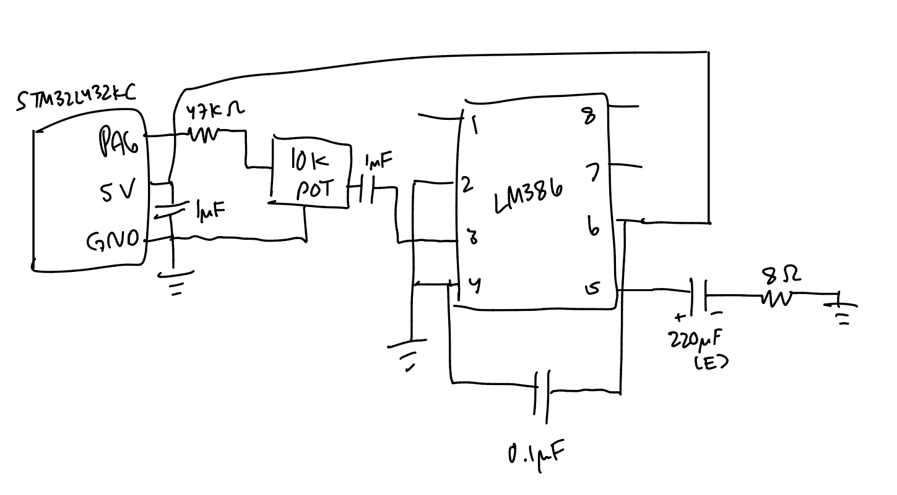
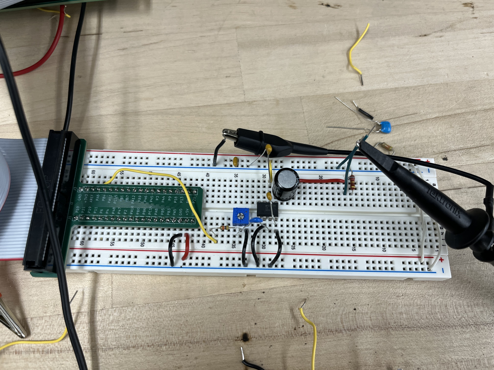
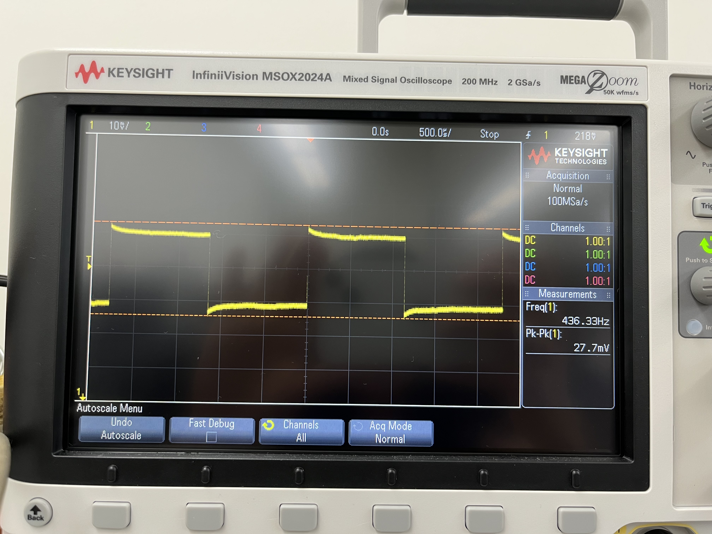

# Introduction

In this lab I used the STM32L432KC to play music on a speaker. One timer (TIM16) makes a square wave on pin PA6, and its frequency sets the pitch of the note. A second timer (TIM15) controls how long each note lasts. The signal goes through an LM386 amplifier and then to the speaker, with a potentiometer to change the volume. The board plays fur elise and then afterwards morning mood from peer gynt suite.

# Design

## Code

I split code into three files:

- `main.c` has the two songs and a loop that plays each note.
- `timer.h` lists the timer functions.
- `timer.c` sets up the clock and the timers, and has `set_freq()` and `delay_ms()`.

Each song is just a list of `{frequency, duration}` pairs. A frequency of 0 is a rest, and a duration of 0 means the song is over. I set up the timers by writing directly to their registers, using structs and `#define` base addresses.

## Pitch (TIM16)

The system clock is 80 MHz. I set the TIM16 prescaler to 25 (bc 80mhz/25+1 = 3MHz and low freqs like 220 Hz fit nicely in a 16bit ARR), so the timer counts at:

80 MHz / 26 = 3,076,923 Hz

To play a note, `set_freq()` sets:

- ARR = (3,076,923 / frequency) - 1
- CCR1 = (ARR + 1) / 2, so the wave is high half the time

The frequency that actually comes out is 3,076,923 / (ARR + 1).

For a rest, `set_freq(0)` just turns the output off. It returns before doing any math, so it never divides by zero.

## Duration (TIM15)

I set the TIM15 psc to 7999, so it counts at:

80 MHz / 8000 = 10,000 Hz, one count every 0.1 ms

So a note of D milliseconds takes 10 × D counts. `delay_ms()` loads that count into the timer and waits until it finishes. All the note lengths in the songs (125, 250, 375, 500, 750 and 1000 ms) come out exact.

## Avoiding math errors

- `set_freq()` never divides by zero, because a frequency of 0 returns early.
- `set_freq()` keeps the frequency between 47 Hz and 1,538,461 Hz, so ARR always fits in the 16-bit timer.
- `delay_ms()` splits anything longer than 6553 ms into smaller pieces, so the timer never overflows.

# Calculations

## 220 Hz and 1000 Hz

Ex for 220 Hz:

- ARR = (3,076,923 / 220) - 1 = 13986 - 1 = 13985
- Actual frequency = 3,076,923 / 13986 = 220.0002 Hz
- Error = 0.0002 / 220 = 0.0001%

For 1000 Hz:

- ARR = (3,076,923 / 1000) - 1 = 3075
- Actual frequency = 3,076,923 / 3076 = 1000.30 Hz
- Error = 0.03%

Both are under 1%.

## Notes in Fur Elise

| Note (Hz) | Actual (Hz) | Error |
|---|---|---|
| 262 | 262.02 | 0.008% |
| 294 (Morning Mood only) | 294.02 | 0.007% |
| 330 | 330.00 | 0.0001% |
| 349 | 349.02 | 0.005% |
| 392 | 392.01 | 0.004% |
| 416 | 416.03 | 0.006% |
| 440 | 440.00 | 0.0001% |
| 494 | 494.05 | 0.010% |
| 523 | 523.02 | 0.004% |
| 587 | 587.09 | 0.015% |
| 623 | 623.11 | 0.018% |
| 659 | 659.01 | 0.002% |
| 699 | 699.14 | 0.020% |
| 1319 | 1319.44 | 0.033% |

The worst note is 1319 Hz, and it is only off by 0.033%.

**Is checking 220 Hz and 1000 Hz enough?** No. ARR has to be a whole number, so the error jumps around from note to note, so two spot checks don't prove anything about the others. But the rounding can never be more than one count, so the error is always less than about frequency / 3,076,923. That bound gets bigger as the frequency goes up. At the highest note (1319 Hz) it is only 0.04%, so every note in the song is within 1%.

## Frequency range

- **Lowest:** the biggest ARR is 65535, so the lowest frequency is 3,076,923 / 65536 = 46.95 Hz. Code gives whole number so: 47 Hz.
- **Highest:** a square wave needs at least 2 counts, so the highest frequency is 3,076,923 / 2 = 1.54 MHz. Too high to hear.

## Duration range

- **Shortest:** the timer counts every 0.1 ms, but `delay_ms()` takes whole milliseconds, so the shortest note is 1 ms.
- **Longest in one timer run:** 65536 counts × 0.1 ms = 6553.6 ms, so 6553 ms as a whole number. 

# Hardware

## Schematic

{width=100%}

The schematic only shows the parts I had on the breadboard. The rest of the board is in the [E155 motherboard schematic](TODO-link).

PA6 goes through a 47 kΩ resistor into a 10 kΩ potentiometer, which works as the volume knob. The resistor and pot bring the 3.3 V signal down to a small audio signal. The pot's middle pin goes through a 1 µF capacitor into pin 3 of the LM386. Pins 2 and 4 go to ground, and pin 6 goes to 5 V with a 1 µF capacitor to ground. Pins 1 and 8 are left open, so the gain is 20. The output on pin 5 goes through a 220 µF capacitor to the 8 Ω speaker.

## Breadboard

<details>
<summary>Breadboard photo</summary>

{width=80%}

</details>

## Testing

I listened to both songs to check the pitch and the tempo, and I measured the signal on the oscilloscope while an A (440 Hz) note played.

{width=80%}

The scope measured 436.33 Hz, which is 0.83% low. That's still within 1%. It's more error than my math predicts, which is probably because the chip's internal clock isn't perfectly accurate.

# Results

My design meets all of the requirements!

# AI Prototype

I prompted Claude:

> What timers should I use on the STM32L432KC to generate frequencies ranging from 220Hz to 1kHz? What's the best choice of timer if I want to easily connect it to a GPIO pin? What formulae are relevant, and what registers need to be set to configure them properly?


- **Timer choice:** TIM6 and TIM7 can't drive a pin, so they won't work. It recommended TIM2 because it is 32-bit and doesn't need the extra BDTR setup. TIM16 on PA6 (AF14) or TIM15 on PA2 (AF14) also work, but you have to set the MOE bit in `TIMx_BDTR` or the pin never outputs anything.
- **Formulas:** f_out = f_clk / ((PSC + 1)(ARR + 1)), and CCR1 = (ARR + 1) / 2 for a 50% square wave. For a 16-bit timer at 80 MHz, 220 Hz needs about 363,636 counts, which doesn't fit in 16 bits, so the prescaler has to be at least 5.
- **Registers:** turn on the GPIO and timer clocks in RCC, set the pin to alternate function mode (MODER and AFRL), set PSC, ARR and CCR1, set PWM mode 1 in CCMR1, enable the output with CCER, start the counter with CR1, and force an update with EGR.
- **Changing notes:** with the ARR and CCR1 preload bits on, new values only take effect at the next update, so notes change without glitches. For a rest, set CCR1 to 0 or clear CC1E.

<details>
<summary>AI prototype code (TIM2 PWM on PA0)</summary>

```c
RCC->AHB2ENR  |= RCC_AHB2ENR_GPIOAEN;
RCC->APB1ENR1 |= RCC_APB1ENR1_TIM2EN;

GPIOA->MODER &= ~(3u << 0);  GPIOA->MODER |= (2u << 0);
GPIOA->AFR[0] &= ~(0xFu << 0); GPIOA->AFR[0] |= (1u << 0);

TIM2->PSC   = 0;
TIM2->ARR   = (80000000u / 440) - 1;     // example: A4
TIM2->CCR1  = (TIM2->ARR + 1) / 2;
TIM2->CCMR1 = (6u << 4) | (1u << 3);     // PWM1 + preload
TIM2->CCER  = TIM_CCER_CC1E;
TIM2->CR1   = TIM_CR1_ARPE | TIM_CR1_CEN;
TIM2->EGR   = TIM_EGR_UG;
```

</details>

**Reflection:** The AI's answer was a helpful starting point, and its formulas and register list match what I ended up using. But a few changes were needed to meet the spces:

- I used TIM16 on PA6 instead of TIM2. The AI's tip about the MOE bit was good, bc without it TIM16 doesn't output anything.
- The AI's code uses CMSIS names like `RCC_AHB2ENR_GPIOAEN`. The lab requires my own structs and `#define`s, so I wrote those myself.
- The AI only covered making the pitch. I still had to add a second timer (TIM15) to time each note, and handle rests and the end of the song.
- Overall I think it was very helpful but iwthout context of like looking through the manual yourself and getting a feel for the registers, it would be super confusing to use AI as a starting point.

# Hours

I spent ~12 hours on this lab

# Code

<details>
<summary>main.c</summary>

```c
#include "timer.h"
#include <stdint.h>

// made uint just for peace of mind i guess
const uint32_t notes[][2] = {
    {659, 125},
    {623, 125},
    {659, 125},
    {623, 125},
    {659, 125},
    {494, 125},
    {587, 125},
    {523, 125},
    {440, 250},
    {  0, 125},
    {262, 125},
    {330, 125},
    {440, 125},
    {494, 250},
    {  0, 125},
    {330, 125},
    {416, 125},
    {494, 125},
    {523, 250},
    {  0, 125},
    {330, 125},
    {659, 125},
    {623, 125},
    {659, 125},
    {623, 125},
    {659, 125},
    {494, 125},
    {587, 125},
    {523, 125},
    {440, 250},
    {  0, 125},
    {262, 125},
    {330, 125},
    {440, 125},
    {494, 250},
    {  0, 125},
    {330, 125},
    {523, 125},
    {494, 125},
    {440, 250},
    {  0, 125},
    {494, 125},
    {523, 125},
    {587, 125},
    {659, 375},
    {392, 125},
    {699, 125},
    {659, 125},
    {587, 375},
    {349, 125},
    {659, 125},
    {587, 125},
    {523, 375},
    {330, 125},
    {587, 125},
    {523, 125},
    {494, 250},
    {  0, 125},
    {330, 125},
    {659, 125},
    {  0, 250},
    {659, 125},
    {1319,125},
    {  0, 250},
    {623, 125},
    {659, 125},
    {  0, 250},
    {623, 125},
    {659, 125},
    {623, 125},
    {659, 125},
    {623, 125},
    {659, 125},
    {494, 125},
    {587, 125},
    {523, 125},
    {440, 250},
    {  0, 125},
    {262, 125},
    {330, 125},
    {440, 125},
    {494, 250},
    {  0, 125},
    {330, 125},
    {416, 125},
    {494, 125},
    {523, 250},
    {  0, 125},
    {330, 125},
    {659, 125},
    {623, 125},
    {659, 125},
    {623, 125},
    {659, 125},
    {494, 125},
    {587, 125},
    {523, 125},
    {440, 250},
    {  0, 125},
    {262, 125},
    {330, 125},
    {440, 125},
    {494, 250},
    {  0, 125},
    {330, 125},
    {523, 125},
    {494, 125},
    {440, 500},

    {0, 0}
};

const uint32_t more[][2] = {
    {392, 250},
    {330, 250},
    {294, 250},
    {262, 250},
    {294, 250},
    {330, 500},

    {392, 250},
    {330, 250},
    {294, 250},
    {262, 250},
    {294, 250},
    {330, 250},
    {294, 250},
    {330, 500},

    {392, 250},
    {330, 250},
    {392, 250},
    {440, 250},
    {330, 250},
    {440, 500},

    {392, 250},
    {330, 250},
    {294, 250},
    {262, 750},

    {0, 0}
};

int main(void)
{
    timers_init();

    int i = 0;

    // fur elise
    while (notes[i][1] != 0)
    {
        set_freq(notes[i][0]);
        delay_ms(notes[i][1]);
        i++;
    }

    set_freq(0);
    delay_ms(1000);

    // song 2
    i = 0;

    while (more[i][1] != 0)
    {
        set_freq(more[i][0]);
        delay_ms(more[i][1]);
        i++;
    }

    // end
    set_freq(0);

    while (1)
    {
    }
}


```

</details>

<details>
<summary>timer.h</summary>

```c

// config file for timer.h

// function defs

#ifndef TIMER_H
#define TIMER_H

#include <stdint.h>

void timers_init(void);
void set_freq(uint32_t freq_hz);
void delay_ms(uint32_t duration_ms);

#endif


```

</details>

<details>
<summary>timer.c</summary>

```c
// flash/80mhz clk
// rcc peripheral clks
// pa6 alternate function
// tim16 pwm
// tim15 duration timer
// set_freq() func
// delay_ms() func

#include "timer.h"

#define __IO volatile

// ========================================================
// BIG CLOCK 
// ==========================================================

// This file configures the MCU for an 80 MHz system clock
#define SYSTEM_CLOCK_HZ 80000000UL


// ==========================================================
// BASE ADDRS
// ==========================================================

#define FLASH_BASE  0x40022000UL
#define RCC_BASE    0x40021000UL
#define GPIOA_BASE  0x48000000UL

#define TIM15_BASE  0x40014000UL
#define TIM16_BASE  0x40014400UL


// =====================================================
// FLASH REGS
// ====================================================

typedef struct
{
    __IO uint32_t ACR;       // 0x00
    __IO uint32_t KEYR;      // 0x04
    __IO uint32_t OPTKEYR;   // 0x08
    __IO uint32_t SR;        // 0x0C
    __IO uint32_t CR;        // 0x10
} FLASH_TypeDef;

#define FLASH ((FLASH_TypeDef *) FLASH_BASE)


// ====================================================
// RCC REGS
// ===================================================

typedef struct
{
    __IO uint32_t CR;          // 0x00
    __IO uint32_t ICSCR;       // 0x04
    __IO uint32_t CFGR;        // 0x08
    __IO uint32_t PLLCFGR;     // 0x0C
    __IO uint32_t PLLSAI1CFGR; // 0x10

         uint32_t RESERVED0;   // 0x14

    __IO uint32_t CIER;        // 0x18
    __IO uint32_t CIFR;        // 0x1C
    __IO uint32_t CICR;        // 0x20

         uint32_t RESERVED1;   // 0x24

    __IO uint32_t AHB1RSTR;    // 0x28
    __IO uint32_t AHB2RSTR;    // 0x2C
    __IO uint32_t AHB3RSTR;    // 0x30

         uint32_t RESERVED2;   // 0x34

    __IO uint32_t APB1RSTR1;   // 0x38
    __IO uint32_t APB1RSTR2;   // 0x3C
    __IO uint32_t APB2RSTR;    // 0x40

         uint32_t RESERVED3;   // 0x44

    __IO uint32_t AHB1ENR;     // 0x48
    __IO uint32_t AHB2ENR;     // 0x4C
    __IO uint32_t AHB3ENR;     // 0x50

         uint32_t RESERVED4;   // 0x54

    __IO uint32_t APB1ENR1;    // 0x58
    __IO uint32_t APB1ENR2;    // 0x5C
    __IO uint32_t APB2ENR;     // 0x60

} RCC_TypeDef;

#define RCC ((RCC_TypeDef *) RCC_BASE)


// =====================================================
// GPIOA REGS
// ===================================================

typedef struct
{
    __IO uint32_t MODER;      // 0x00
    __IO uint32_t OTYPER;     // 0x04
    __IO uint32_t OSPEEDR;    // 0x08
    __IO uint32_t PUPDR;      // 0x0C
    __IO uint32_t IDR;        // 0x10
    __IO uint32_t ODR;        // 0x14
    __IO uint32_t BSRR;       // 0x18
    __IO uint32_t LCKR;       // 0x1C
    __IO uint32_t AFRL;       // 0x20
    __IO uint32_t AFRH;       // 0x24
} GPIO_TypeDef;

#define GPIOA ((GPIO_TypeDef *) GPIOA_BASE)


// ==================================================
// TIM15 REGS
// =====================================================

typedef struct
{
    __IO uint32_t CR1;        // 0x00
    __IO uint32_t CR2;        // 0x04
    __IO uint32_t SMCR;       // 0x08
    __IO uint32_t DIER;       // 0x0C
    __IO uint32_t SR;         // 0x10
    __IO uint32_t EGR;        // 0x14
    __IO uint32_t CCMR1;      // 0x18

         uint32_t RESERVED0;  // 0x1C

    __IO uint32_t CCER;       // 0x20
    __IO uint32_t CNT;        // 0x24
    __IO uint32_t PSC;        // 0x28
    __IO uint32_t ARR;        // 0x2C
    __IO uint32_t RCR;        // 0x30
    __IO uint32_t CCR1;       // 0x34
    __IO uint32_t CCR2;       // 0x38

         uint32_t RESERVED1;  // 0x3C
         uint32_t RESERVED2;  // 0x40

    __IO uint32_t BDTR;       // 0x44

} TIM15_TypeDef;

#define TIM15 ((TIM15_TypeDef *) TIM15_BASE)


// ==================================================
// TIM16 REGS
// ====================================================

typedef struct
{
    __IO uint32_t CR1;        // 0x00
    __IO uint32_t CR2;        // 0x04

         uint32_t RESERVED0;  // 0x08

    __IO uint32_t DIER;       // 0x0C
    __IO uint32_t SR;         // 0x10
    __IO uint32_t EGR;        // 0x14
    __IO uint32_t CCMR1;      // 0x18

         uint32_t RESERVED1;  // 0x1C

    __IO uint32_t CCER;       // 0x20
    __IO uint32_t CNT;        // 0x24
    __IO uint32_t PSC;        // 0x28
    __IO uint32_t ARR;        // 0x2C
    __IO uint32_t RCR;        // 0x30
    __IO uint32_t CCR1;       // 0x34

         uint32_t RESERVED2;  // 0x38
         uint32_t RESERVED3;  // 0x3C
         uint32_t RESERVED4;  // 0x40

    __IO uint32_t BDTR;       // 0x44

} TIM16_TypeDef;

#define TIM16 ((TIM16_TypeDef *) TIM16_BASE)


// ================================================
// TIMER SETTINGS
// ===================================================

// TIM16 PWM prescaler
// Counter frequency = 80 MHz / (25 + 1)
#define PWM_PSC 25U

// TIM15 prescaler
// 80 MHz / (7999 + 1) = 10 kHz
// Therefore 1 ms = 10 counter ticks
#define DELAY_PSC      7999U
#define COUNTS_PER_MS  10U


// =================================================
// PRIVATE INIT FNS
// =================================================


// ------------------------------------------------------------
// Configure for 80 MHz
// ------------------------------------------------------------

static void clock_init(void)
{
    // Set flash latency / configuration
    // This is adapted from the FLASH setup in the older project
    FLASH->ACR |= 0b100;
    FLASH->ACR |= (1U << 8);

    // Turn PLL off before changing its configuration
    RCC->CR &= ~(1U << 24);

    // Wait until PLLRDY goes low
    while (RCC->CR & (1U << 25))
    {
    }

    // PLL source = MSI
    RCC->PLLCFGR &= ~(3U << 0);
    RCC->PLLCFGR |=  (1U << 0);

    // PLLM = divide by 1
    RCC->PLLCFGR &= ~(7U << 4);

    // PLLN = 80
    RCC->PLLCFGR &= ~(0xFFU << 8);
    RCC->PLLCFGR |=  (80U << 8);

    // PLLR = divide by 4
    RCC->PLLCFGR &= ~(3U << 25);
    RCC->PLLCFGR |=  (1U << 25);

    // Enable PLLR output
    RCC->PLLCFGR |= (1U << 24);

    // Enable PLL
    RCC->CR |= (1U << 24);

    // Wait until PLL locks
    while (!(RCC->CR & (1U << 25)))
    {
    }

    // Select PLL as system clock
    RCC->CFGR &= ~(3U << 0);
    RCC->CFGR |=  (3U << 0);

    // Wait until PLL is actually the system clock
    while (((RCC->CFGR >> 2) & 3U) != 3U)
    {
    }
}


// -------------------------------------------------------
// Configure PA6 as TIM16_CH1 output
// -------------------------------------------------------

static void pwm_gpio_init(void)
{
    // Enable GPIOA clock
    RCC->AHB2ENR |= (1U << 0);

    // PA6 MODER = 10 -> alternate-function mode
    GPIOA->MODER &= ~(3U << (6U * 2U));
    GPIOA->MODER |=  (2U << (6U * 2U));

    // PA6 uses AFRL because it is pin 0-7
    // AF14 maps PA6 to TIM16_CH1
    GPIOA->AFRL &= ~(0xFU << (6U * 4U));
    GPIOA->AFRL |=  (14U  << (6U * 4U));
}


// ---------------------------------------------------------
// Configure TIM16 for PWM generation
// ------------------------------------------------------

static void tim16_init(void)
{
    // Turn on TIM16 peripheral clock
    RCC->APB2ENR |= (1U << 17);

    // Stop counter while configuring
    TIM16->CR1 &= ~(1U << 0);

    // PWM timer prescaler
    TIM16->PSC = PWM_PSC;

    // Enable ARR preload
    TIM16->CR1 |= (1U << 7);

    // OC1M = 110 -> PWM Mode 1
    TIM16->CCMR1 &= ~(7U << 4);
    TIM16->CCMR1 |=  (6U << 4);

    // Enable CCR1 preload
    TIM16->CCMR1 |= (1U << 3);

    // Active-high output
    TIM16->CCER &= ~(1U << 1);

    // Leave CC1E = 0 for now
    // set_freq() will enable output
    TIM16->CCER &= ~(1U << 0);

    // Main output enable
    TIM16->BDTR |= (1U << 15);

    // Load prescaler
    TIM16->EGR |= (1U << 0);

    // Start timer counter
    TIM16->CR1 |= (1U << 0);
}


// ------------------------------------------------------
// Configure TIM15 as note-duration timer
// ---------------------------------------------------------

static void tim15_init(void)
{
    // Enable TIM15 clock in RCC APB2ENR
    RCC->APB2ENR |= (1U << 16);

    // Stop while configuring
    TIM15->CR1 &= ~(1U << 0);

    // 80 MHz / 8000 = 10 kHz
    TIM15->PSC = DELAY_PSC;

    // Generate update event so PSC takes effect
    TIM15->EGR |= (1U << 0);

    // Clear UIF
    TIM15->SR &= ~(1U << 0);
}


// =========================================================
// PUBLIC FUNCTIONS
// =========================================================


void timers_init(void)
{
    clock_init();

    pwm_gpio_init();

    tim15_init();

    tim16_init();
}


// -----------------------------------------------------
// Change TIM16 PWM frequency
// ----------------------------------------------------

void set_freq(uint32_t freq_hz)
{
    // Disable output while changing frequency
    TIM16->CCER &= ~(1U << 0);

    if (freq_hz == 0U)
    {
        // Rest: simply leave output disabled
        return;
    }

    uint32_t timer_counter_hz =
        SYSTEM_CLOCK_HZ / (PWM_PSC + 1U);

    uint32_t arr =
        (timer_counter_hz / freq_hz) - 1U;

    TIM16->CNT  = 0U;
    TIM16->ARR  = arr;
    TIM16->CCR1 = (arr + 1U) / 2U;

    // Force update of preload registers
    TIM16->EGR |= (1U << 0);

    // Now expose PWM on channel 1
    TIM16->CCER |= (1U << 0);
}


// ---------------------------------------------------------
// Delay for specified number of milliseconds using TIM15
// ---------------------------------------------------------

void delay_ms(uint32_t duration_ms)
{
    if (duration_ms == 0U)
    {
        return;
    }

    // At 10 kHz:
    //
    // 1 ms = 10 counts
    uint32_t counts =
        duration_ms * COUNTS_PER_MS;

    // Stop TIM15 before setting up new delay
    TIM15->CR1 &= ~(1U << 0);

    // Start from zero
    TIM15->CNT = 0U;

    // Set terminal count
    TIM15->ARR = counts - 1U;

    // Generate update event so ARR is loaded
    TIM15->EGR |= (1U << 0);

    // EGR update sets UIF, so clear it before timing
    TIM15->SR &= ~(1U << 0);

    // Start timer
    TIM15->CR1 |= (1U << 0);

    // Wait until TIM15 reaches ARR and hardware sets UIF
    //
    // While the CPU waits here, TIM16 continues generating
    // the audio PWM completely independently
    while (!(TIM15->SR & (1U << 0)))
    {
    }

    // Stop timer
    TIM15->CR1 &= ~(1U << 0);

    // Clear flag for next note
    TIM15->SR &= ~(1U << 0);

  }


```

</details>
