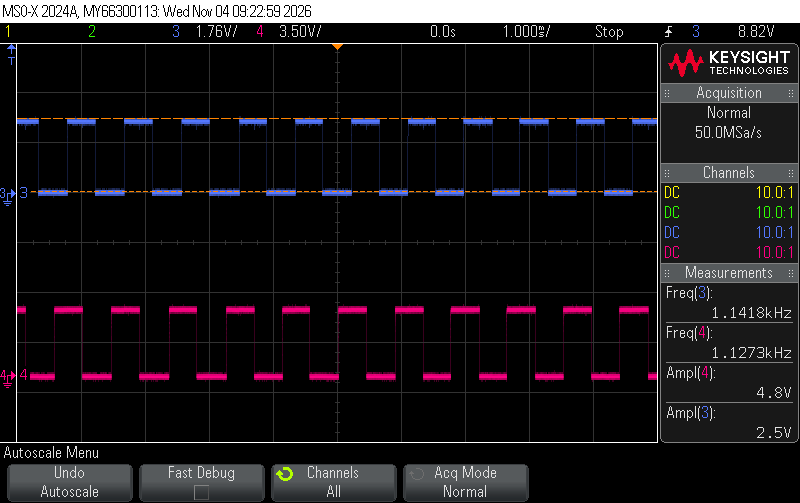

# Introduction

In this lab I used the STM32L432KC to measure the speed and direction of a 25GA-370 DC motor. The motor has a quadrature encoder on the back, which is two hall effect sensors (A and B) that pulse as a magnet on the shaft spins past them. The MCU gets an interrupt on every edge of A and B, keeps track of which way the shaft moved and when, and once a second prints the speed in rev/s and the direction (CW or CCW) to the SEGGER debug terminal.

# Design and Testing Methodology

## Overall Design

I split the code into these files:

- [`main.c`](#main-c): sets everything up, then every 1 s calculates the speed and prints it
- [`main.h`](#main-h): gear ratio and timing settings
- [`encoder.c`](#encoder-c) / [`encoder.h`](#encoder-h): sets up the pins, the interrupts and a 1 MHz timer, and has the interrupt handler
- `lib/`: course GPIO, RCC and FLASH drivers (80 MHz clock)

The interrupt handler only updates a few shared variables: `position` (signed count of steps), `edgeTime` (TIM2 time of the last step) and `badEdges` (missed edges). main reads them once a second and does all the math and printing, so the handler stays really short. The shared variables are `volatile` since the interrupt can change them at any time. Otherwise the compiler could keep an old copy in a register and main would never see the new value.

## Quadrature Encoder

With only channel A you could count pulses to get the speed, but you wouldn't know which way the motor is spinning. B is 90° out of phase with A, so going one way A changes first and going the other way B changes first. Together A and B go through 4 states. CW is AB = 00 → 10 → 11 → 01 → 00 and CCW is the same thing backwards. Every edge on either channel is one step, so there are 4 edges per pulse, which is 4x the resolution of only counting rising edges on A.

Every time the interrupt runs it reads A and B and compares them to last time with this table:

| old ↓ / new → | 00 | 01 | 10 | 11 |
|---|---|---|---|---|
| **00** | 0 | -1 | +1 | ✗ |
| **01** | +1 | 0 | ✗ | -1 |
| **10** | -1 | ✗ | 0 | +1 |
| **11** | ✗ | +1 | -1 | 0 |

So if AB was 00 and A goes high, AB is now 10. Row 00 column 10 is +1, so one step CW. If B had gone high instead (00 → 01) it's -1, one step CCW. The step gets added to `position`, so the direction is just whether `position` went up or down.

✗ means A and B both changed at once. That can't happen with a real encoder since they're 90° apart, so it means the MCU missed an edge. Those get counted in `badEdges` and main prints a warning if it ever goes up.

I read A and B with one read of `GPIOA->IDR` since they're both on port A. If I read them separately one could change in between and I'd get a state that never happened. The table is just an array of 16 numbers indexed by (old AB × 4) + new AB, so the handler doesn't need any if statements to figure out the direction.

## Interrupts

The other option is polling, where main keeps reading the pins in a loop. The problem is anything else main does (like printf) is time it isn't looking at the pins, so it can miss an edge. With interrupts the hardware catches the edge on its own and stops whatever the CPU is doing to run the handler, so edges don't get missed even while main is printing.

To set it up I turned on the SYSCFG clock in `RCC->APB2ENR`, then used `SYSCFG->EXTICR` to connect EXTI6 to PA6 and EXTI8 to PA8. I set both lines in `EXTI->RTSR1` and `EXTI->FTSR1` so they trigger on rising and falling edges, unmasked them in `EXTI->IMR1`, and turned on `EXTI9_5_IRQn` in the NVIC. Lines 5-9 share one interrupt so A and B both go to `EXTI9_5_IRQHandler`. Before turning anything on I read A and B once so the first edge gets compared to the right starting state.

In the handler I check which of lines 6 and 8 are pending in `EXTI->PR1` and clear them with `EXTI->PR1 = pending`. It has to be `=` and not `|=` because PR1 clears any bit you write a 1 to, so `|=` would clear every other pending line too. Then it grabs the time from TIM2, reads A and B, looks up the step and adds it to `position`. I clear the flag before reading the pins so if another edge comes right after, the flag gets set again and the handler just runs one more time.

## Calculating Speed

TIM2 is a free running 32-bit timer at 1 MHz (PSC = 79, ARR = 0xFFFFFFFF), so each count is 1 µs and it only wraps every ~71 min. Unsigned subtraction still gives the right difference when it wraps.

Once a second main turns off interrupts for a moment and copies `position`, `edgeTime` and `badEdges`, so `position` and `edgeTime` are always from the same edge. Then:

speed (rev/s) = edges / (time × 1632)

where edges is the change in `position` since last time and time is from the last edge last time to the last edge now. Ex if 3,400 edges came in over 1.0005 s:

3,400 / (1.0005 × 1632) = 2.0823 rev/s

I used the time between real edges instead of just counting edges in each 1 s window because the window can be off by 1 edge depending on where it starts and ends. At my slowest speed (0.0472 rev/s) that's only 77 edges per second, so 1 edge off is 1/77 = 1.3% error. Going edge to edge doesn't have that problem.

If a whole second goes by with no new edge it keeps showing the last speed instead of jumping to 0, and after 3 s with no edges it prints `0 (stopped)`. When the motor starts again the last edge from before it stopped is too old to use, so the first speed is measured from the last time main checked instead. The speed is stored as an integer in micro-rev/s and printed with 4 decimals so I didn't have to turn on float printf in SEGGER.

## Testing Methodology

I checked the printed speed against the encoder frequency on the scope at a few different supply voltages. The scope frequency is pulses per second on one channel, so the real speed is f / 408. I also did one run speeding up and one slowing down to see what it does at the slow end and when the motor stops.

# Technical Documentation

## Code

<details id="main-c">
<summary>main.c</summary>

```c

```

</details>

<details id="main-h">
<summary>main.h</summary>

```c

```

</details>

<details id="encoder-c">
<summary>encoder.c</summary>

```c

```

</details>

<details id="encoder-h">
<summary>encoder.h</summary>

```c

```

</details>

## Pin Assignments

| Signal | MCU pin | Notes |
|---|---|---|
| Encoder A | PA6 | 5 V tolerant, EXTI6 |
| Encoder B | PA8 | 5 V tolerant, EXTI8 |
| Encoder VCC | 5 V | |
| Encoder GND | GND | |
| Motor M+ / M- | 0-12 V bench supply | not connected to the MCU |

The encoder outputs 5 V but the MCU runs at 3.3 V, so A and B go to 5 V tolerant pins (STM32L432KC datasheet Table 14). I turned off the internal pull-up and pull-down on those pins because the datasheet says a 5 V tolerant pin can only go above V~DD~ + 0.3 V with its pull resistors off.

## Hardware Schematic

{width=100%}

The MCU is on the E155 dev board, so I only drew what I added. See the [E155 Development Board Schematic](https://hmc-e155.github.io/assets/doc/E155%20FA22%20Development%20Board%20Schematic.pdf) for the rest.

## Calculations

### Edges per Revolution

The lab page says 12 pulses per motor rev on each channel, and my motor has a 34:1 gearbox.

12 × 34 = 408 pulses per output rev per channel

4 edges per pulse: 4 × 408 = 1632 edges per output rev

360° / 1632 = 0.22° per edge

### Update Rate

main prints every 1,000,000 TIM2 counts = 1 s, so 1 Hz. It adds 1 s to the last print time instead of using the current time so the prints don't drift.

### Slowest Speed

It counts as stopped after 3 s with no edge, so the slowest it can show is 1 edge in 3 s:

1 / (3 × 1632) = 0.0002 rev/s

The slowest I got the motor to actually spin was 0.0472 rev/s at ~0.25 V, and below that it stalls. So the code can go way slower than the motor can.

### Fastest Speed

Getting in and out of an interrupt on the Cortex-M4 is ~24 cycles and my handler is maybe 40-60 more, so ~100 cycles.

100 cycles × 12.5 ns = 1.25 µs per edge

1 / 1.25 µs = 800,000 edges/s → 800,000 / 1632 ≈ 490 rev/s

The fastest I measured was 1134.6 Hz on each channel (scope_72):

1134.6 / 408 = 2.78 rev/s

4 × 1134.6 = 4,538 edges/s, so one edge every 220 µs

The motor is ~175x slower than the limit and the CPU is only in the handler 1.25 / 220 = 0.6% of the time!

### Resolution and Accuracy

Position: 1/1632 rev = 0.22°

Printed speed: 0.0001 rev/s

Timer: 1 µs out of ~1 s, about 0.0001%

The MCU clock is only good to about 1%, so that's the real limit (in lab 4 it was 0.83% off on the scope).

# Results

## Scope Comparison

| Scope capture | Scope freq (Hz) | Scope speed (rev/s) | Printed speed (rev/s) | Error |
|---|---|---|---|---|
| scope_70 | 271.1 | 0.6646 | 0.6636 | -0.14% |
| scope_69 | 556.4 | 1.3637 | 1.3723 | +0.63% |
| scope_71 | 845.5 | 2.0724 | 2.0860 | +0.65% |
| scope_72 | 1134.6 | 2.7808 | 2.8030 | +0.80% |

Scope freq is the average of the two channels and printed speed is the average of the steady readings at that speed. Error is (printed - scope) / scope. Ex for scope_71, 845.5 / 408 = 2.0724 rev/s and the MCU printed 2.0860, so +0.65%.

All within 1%! The MCU reads a little high every time, which makes sense if the clock runs a bit slow since TIM2 would count fewer µs than really went by. In lab 4 the clock was off by about 0.8% in the same direction. You can also see in the captures that A and B are offset by about a quarter period (90°).

<details>
<summary>Scope captures</summary>

{width=100%}

{width=100%}

{width=100%}

{width=100%}

</details>

## Speeding Up and Slowing Down

It says `0 (stopped)` when the motor is off. The first reading after each speed change is somewhere in between (like 0.4169 or 1.2140) since that second has some of the old speed and some of the new one, then it settles. When I cut the power it kept showing 1.8775 for 3 s and then went to 0, which is the stop timeout. Slowing down from 1 V to 0.25 V it got down to 0.0472 rev/s before the motor stalled. No missed edge warnings in either run.

<details>
<summary>Run 1: speeding up</summary>

```
Lab 5 encoder: 1632 edges per output rev (gear 34:1)
speed: +0.0000 rev/s  (stopped)
speed: +0.0000 rev/s  (stopped)
speed: +0.0000 rev/s  (stopped)
speed: +0.0000 rev/s  (stopped)
speed: +0.0000 rev/s  (stopped)
speed: +0.4169 rev/s  (CW)
speed: +0.6638 rev/s  (CW)
speed: +0.6634 rev/s  (CW)
speed: +0.6639 rev/s  (CW)
speed: +0.6633 rev/s  (CW)
speed: +0.6637 rev/s  (CW)
speed: +1.2140 rev/s  (CW)
speed: +1.3713 rev/s  (CW)
speed: +1.3731 rev/s  (CW)
speed: +1.3721 rev/s  (CW)
speed: +1.3727 rev/s  (CW)
speed: +1.5630 rev/s  (CW)
speed: +2.0849 rev/s  (CW)
speed: +2.0856 rev/s  (CW)
speed: +2.0857 rev/s  (CW)
speed: +2.0860 rev/s  (CW)
speed: +2.0878 rev/s  (CW)
speed: +2.2530 rev/s  (CW)
speed: +2.8028 rev/s  (CW)
speed: +2.8025 rev/s  (CW)
speed: +2.8013 rev/s  (CW)
speed: +2.8031 rev/s  (CW)
speed: +2.8034 rev/s  (CW)
speed: +2.8046 rev/s  (CW)
speed: +1.8775 rev/s  (CW)
speed: +1.8775 rev/s  (CW)
speed: +1.8775 rev/s  (CW)
speed: +0.0000 rev/s  (stopped)
speed: +0.0000 rev/s  (stopped)
```

</details>

<details>
<summary>Run 2: slowing down from 1 V to 0.25 V</summary>

```
Lab 5 encoder: 1632 edges per output rev (gear 34:1)
speed: +0.0000 rev/s  (stopped)
speed: +0.0000 rev/s  (stopped)
speed: +0.0000 rev/s  (stopped)
speed: +0.0000 rev/s  (stopped)
speed: +0.1634 rev/s  (CW)
speed: +0.1971 rev/s  (CW)
speed: +0.1965 rev/s  (CW)
speed: +0.1960 rev/s  (CW)
speed: +0.1958 rev/s  (CW)
speed: +0.1956 rev/s  (CW)
speed: +0.1175 rev/s  (CW)
speed: +0.0755 rev/s  (CW)
speed: +0.0760 rev/s  (CW)
speed: +0.0758 rev/s  (CW)
speed: +0.0754 rev/s  (CW)
speed: +0.0760 rev/s  (CW)
speed: +0.0760 rev/s  (CW)
speed: +0.0759 rev/s  (CW)
speed: +0.0472 rev/s  (CW)
speed: +0.0472 rev/s  (CW)
speed: +0.0472 rev/s  (CW)
speed: +0.0000 rev/s  (stopped)
speed: +0.0000 rev/s  (stopped)
speed: +0.0000 rev/s  (stopped)
speed: +0.0000 rev/s  (stopped)
speed: +0.0000 rev/s  (stopped)
speed: +0.0000 rev/s  (stopped)
speed: +0.0000 rev/s  (stopped)
speed: +0.0000 rev/s  (stopped)
speed: +0.0000 rev/s  (stopped)
speed: +0.0000 rev/s  (stopped)
```

</details>

## Direction

Both runs are CW. I'll show CCW at checkoff by swapping the motor leads, which flips the order of A and B so `position` counts down and it prints a negative speed with (CCW).

# Requirements

This design meets all proficiency specifications. CCW isn't in the logs, I'm showing it at checkoff. It also takes up to 3 s to say 0 after the motor stops. I didn't do the excellence documentation (flowchart and the interrupt vs. polling comparison).

# Conclusion

Met all proficiency specifications. Spent ~7 hours on this lab.

# AI Prototype and Reflection

## AI Prototype

I prompted Claude:

> Write me interrupt handlers to interface with a quadrature encoder. I'm using the STM32L432KC, what pins should I connect the encoder to in order to allow it to easily trigger the interrupts?

It picked PA0 (EXTI0) and PA1 (EXTI1) and wrote an x4 decoder with a lookup table, which is basically the same idea as mine. But it was written for the STM32 HAL library (`stm32l4xx_hal.h`, `HAL_GPIO_Init`, `HAL_GPIO_EXTI_Callback`), which isn't in my project since I use the course `lib/` drivers. So it wasn't usable without adding a whole new library and I didn't swap it in. It also said to power the encoder from 3.3 V, but mine needs 5 V. It did point out that TIM2 has a hardware encoder mode, which I didn't know.

## Reflection

The decoding logic was right, but the code depended on a library I wasn't using, so I couldn't just drop it in. Next time I'd tell it to use registers directly or my own drivers.
