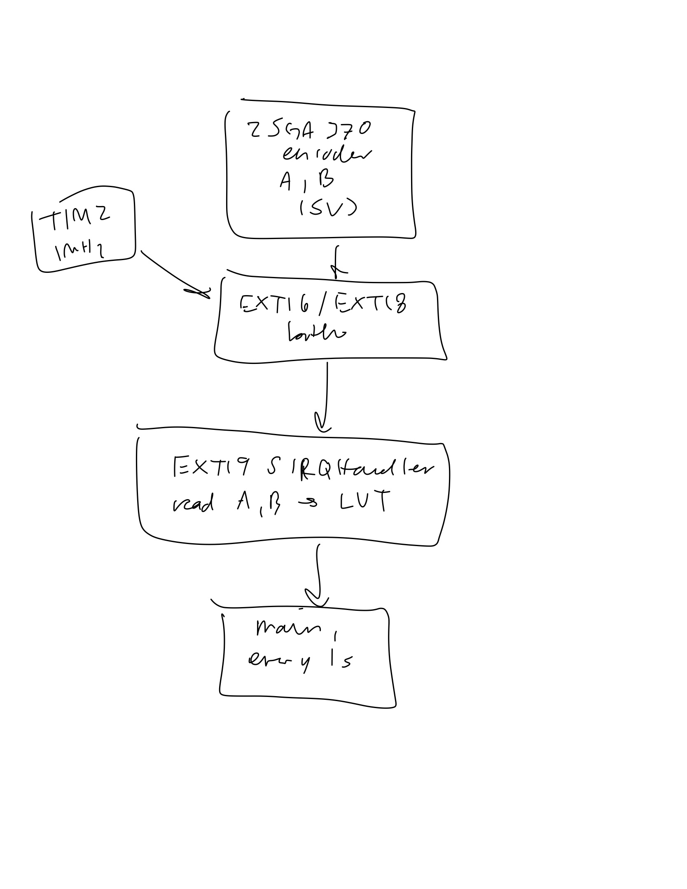
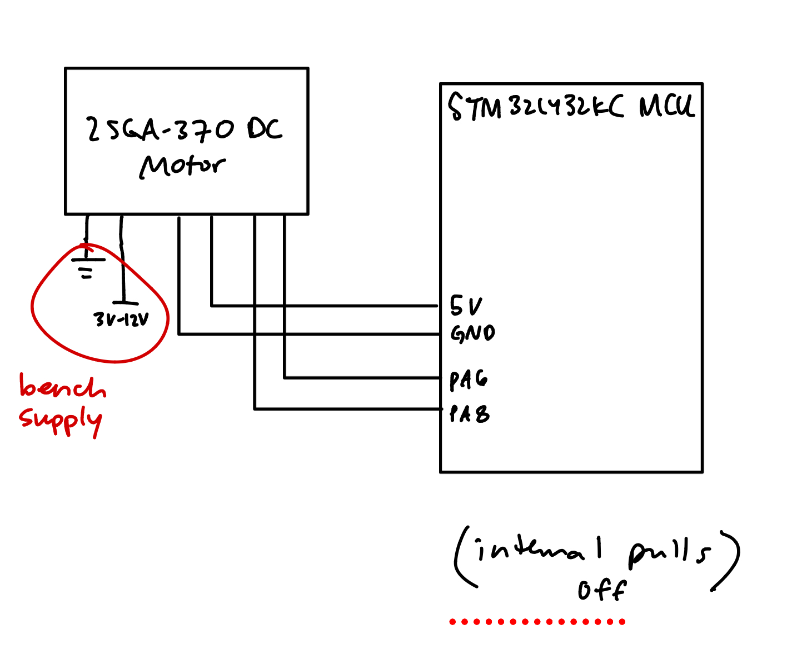
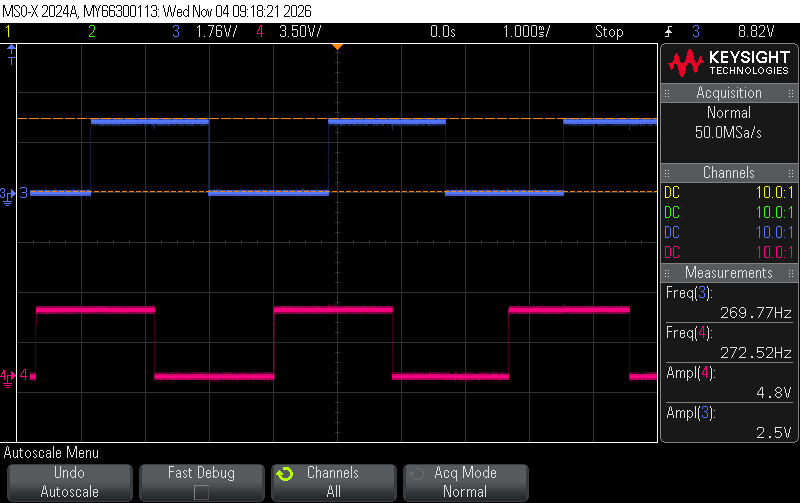

# Introduction

In this lab I used the STM32L432KC to measure how fast a 25GA-370 DC motor spins and which way it's going. The motor has a quadrature encoder on the back: a magnet disk on the motor shaft and two hall sensors (A and B) that switch on and off as the magnet spins past them. That gives two square waves that are 90° apart.

Every rising and falling edge on A or B triggers an interrupt on the MCU. The interrupt checks A and B and figures out if the shaft moved one step forward or one step backward, and saves the time it happened. Once a second the main loop uses those counts and times to calculate the speed in rev/s and prints it with the direction (CW or CCW) in the SEGGER debug terminal.

# Design

## Code

I split code into these files:

- `main.c` sets everything up, and then every 1 s calculates the speed and prints it.
- `main.h` has the gear ratio and timing settings.
- `encoder.c` / `encoder.h` set up the pins, the interrupts and a 1 MHz timer, and has the interrupt handler. Nothing in here depends on the motor, so the gear ratio gets passed in from `main`.
- `lib/` is the course GPIO, RCC (80 MHz) and FLASH drivers, same as lab 6.

## Block Diagram

{width=60%}

There are two parts that run separately:

- **The interrupt** runs every time A or B changes. It only updates three shared variables: `position` (signed count of steps), `edgeTime` (when the last step happened) and `badEdges` (how many edges got missed).
- **The main loop** reads those variables once a second and does all the math and printing.

The shared variables are `volatile` bc the interrupt can change them at any time, and without `volatile` the compiler could keep an old copy in a register and `main` would never see the new value. Keeping the math in `main` means the interrupt is really short, so it's done before the next edge shows up.

## How the Encoder Works

If you only had channel A, you could count pulses to get the speed, but you wouldn't know which way the motor is turning. That's what B is for. B is shifted 90° from A, so:

- Spinning one way, A changes first and then B follows.
- Spinning the other way, B changes first and then A follows.

Looking at both together, the encoder goes through 4 states. Forward is AB = 00 → 10 → 11 → 01 → 00, and backwards is the same loop in reverse. Each edge on either channel moves one step around the loop, so there are 4 edges per pulse. Counting all 4 instead of just the rising edges of A gives 4x the resolution.

## Quadrature Decoding

Every time the interrupt runs, it reads A and B and compares them to what they were last time. The table says which way it moved:

| old ↓ / new → | 00 | 01 | 10 | 11 |
|---|---|---|---|---|
| **00** | 0 | -1 | +1 | ✗ |
| **01** | +1 | 0 | ✗ | -1 |
| **10** | -1 | ✗ | 0 | +1 |
| **11** | ✗ | +1 | -1 | 0 |

For example, if AB was 00 and A goes high, AB is now 10. Row 00, column 10 is +1, so that's one step forward. If B had gone high instead (00 → 01), it's -1, one step backward.

The result gets added to `position`. Going forward it counts up and going backward it counts down, so the direction is just the sign of the change.

Some details:

- I read A and B in one read of `GPIOA->IDR` (both are on port A). If I read them separately, one could change in between and I'd get a state that never really happened.
- ✗ means both A and B changed at the same time. That can't happen with a real encoder, since they're 90° apart. It only shows up if the MCU missed an edge in between. Those get counted in `badEdges` and `main` prints a warning, so I'd know if the interrupts ever couldn't keep up.
- The table is stored as an array of 16 numbers, indexed by (old AB × 4) + new AB, so the interrupt doesn't need any `if` statements to figure out the direction.

## Interrupts

I used interrupts instead of checking the pins in a loop (polling). With polling, the CPU would have to keep reading the pins nonstop, and anything else it does, like printing, takes time where it isn't looking at the pins and could miss an edge. With interrupts, the hardware notices the edge by itself and stops whatever the CPU is doing to run the handler, so no edge gets skipped even while `main` is printing.

How I set it up:

1. **Turn on SYSCFG** in `RCC->APB2ENR`. SYSCFG is the part that decides which port each EXTI line listens to, so its clock has to be on.
2. **Route the pins** with `SYSCFG->EXTICR`. EXTI line 6 can come from PA6, PB6, PC6..., so I set it to port A. Same for line 8 → PA8.
3. **Pick the edges** with `EXTI->RTSR1` (rising) and `EXTI->FTSR1` (falling). I set both for both lines, bc I want all 4 edges.
4. **Unmask** lines 6 and 8 in `EXTI->IMR1` so they're actually allowed to cause an interrupt.
5. **Turn on the interrupt in the NVIC** with `NVIC_EnableIRQ(EXTI9_5_IRQn)`. Lines 5-9 all share one interrupt, so both A and B go to the same handler, `EXTI9_5_IRQHandler`.
6. **Enable interrupts globally** with `__enable_irq()`.

Before turning anything on, I also read A and B once to set the starting state, so the first edge gets compared against the right thing.

What the handler does every edge:

1. Checks which of lines 6/8 are pending in `EXTI->PR1`.
2. Clears them with `EXTI->PR1 = pending`. PR1 clears whatever bits you write a 1 to, so using `|=` would read all the pending bits and write them all back, which clears every other pending line too.
3. Saves the time from TIM2.
4. Reads A and B, looks up the step in the table, and adds it to `position` (or adds 1 to `badEdges`).

I clear the flag before reading the pins on purpose. If another edge happens right after I read the pins, it sets the flag again and the handler just runs one more time, so that edge doesn't get lost.

## Speed

To know when each edge happened I use TIM2 as a clock. It counts at 1 MHz (PSC = 80 - 1 from the 80 MHz clock, ARR = 0xFFFFFFFF), so each count is 1 µs. It's a 32-bit timer so it only wraps around every ~71 min, and subtracting two times with unsigned math still works when it wraps. Every edge saves the TIM2 count as `edgeTime`.

Once a second, `main`:

1. Turns off interrupts for a moment, copies `position`, `edgeTime` and `badEdges`, and turns them back on. This makes sure `position` and `edgeTime` come from the same edge. Otherwise an interrupt could happen in between copying the two and they wouldn't match.
2. Calculates how many edges happened since last time, and how much time passed between the last edge last time and the last edge now.
3. Divides to get the speed:

speed (rev/s) = edges / (time × edges per rev)

For example, if 3,400 edges came in and the time between the two edges was 1,000,500 µs:

3,400 / (1.0005 s × 1632) = 2.0823 rev/s

I used the time between actual edges instead of just counting edges in each 1 s bc counting in a fixed window can be off by 1 edge depending on where the window starts and ends. At my slowest speed (0.0472 rev/s) there are only 0.0472 × 1632 = 77 edges per second, so being off by 1 edge would make the speed jump around by 1.3%. Measuring from edge to edge doesn't have that problem.

Special cases:

- **Really slow:** if a whole second goes by with no new edge, it keeps showing the last speed instead of jumping to 0. After 3 s with no edges it prints `0 (stopped)`.
- **Starting up:** when the motor starts again, the last edge from before it stopped is too old to use, so the first speed is measured from the last time `main` checked instead.
- **Divide by zero:** if the time is 0, the speed function returns 0 instead of dividing.

The speed is stored as a whole number in micro-rev/s (millionths of a rev/s) and printed with 4 decimals. That way printf doesn't need float support turned on in SEGGER.

# Calculations

## Edges per revolution

The lab page says the encoder makes 12 pulses per motor revolution on each channel. My motor is the -34 one (34:1 gearbox):

- 12 × 34 = 408 pulses per output shaft revolution per channel
- Both edges of both channels: 4 × 408 = 1632 edges/rev
- 360° / 1632 = 0.22° per edge

## Update rate

`main` prints every 1,000,000 µs on TIM2 = 1 Hz, which meets the 1 Hz requirement. It adds 1 s to the last print time instead of using "now", so the prints don't drift.

## Slowest speed

The motor counts as stopped after 3 s with no edge, so the slowest speed that still shows up is 1 edge every 3 s:

1 / (3 × 1632) = 0.0002 rev/s

The slowest I actually got the motor to spin was 0.0472 rev/s (turning the supply down to ~0.25 V). Below that the motor just stalls, so the code can go way slower than the motor can.

## Fastest speed

Every edge is one interrupt. Getting in and out of an interrupt on the Cortex-M4 is about 24 cycles and my handler is maybe 40-60 more, so call it ~100 cycles = 1.25 µs at 80 MHz. The next edge has to come after the handler is done, so the max is about:

1 / 1.25 µs = 800,000 edges/s → 800,000 / 1632 ≈ 490 rev/s

The fastest I measured on the scope was 845.5 Hz on each channel (scope_71), which is:

845.5 / 408 = 2.07 rev/s → 4 × 845.5 = 3,382 edges/s, one edge every ~296 µs

So the motor is ~240x slower than the limit, and the CPU is only in the interrupt about 1.25 / 296 = 0.4% of the time. The missed edge warning never printed in any of my runs.

## Resolution and accuracy

- Position: 1 edge = 1/1632 rev = 0.22°
- Printed speed: 0.0001 rev/s
- Timer: 1 µs over ~1 s → about 0.0001%
- Clock: the internal clock is only good to about 1%, so that's the real limit (in lab 4 the scope read 0.83% off)

# Hardware

## Pin Assignments

| Signal | MCU pin | Notes |
|---|---|---|
| Encoder A | PA6 | 5 V tolerant, EXTI6 |
| Encoder B | PA8 | 5 V tolerant, EXTI8 |
| Encoder VCC | 5 V | |
| Encoder GND | GND | |
| Motor + / - | 12 V bench supply | not connected to the MCU |

The encoder puts out 5 V but the MCU runs at 3.3 V, so A and B go to pins that are 5 V tolerant (STM32L432KC datasheet Table 14). I turned the internal pull-up and pull-down off on those pins bc the datasheet says a 5 V tolerant pin can only go above V~DD~ + 0.3 V when its pull resistors are off.
## Schematic

{width=100%}

The MCU is on the E155 dev board, see the [E155 Development Board Schematic](https://hmc-e155.github.io/assets/doc/E155%20FA22%20Development%20Board%20Schematic.pdf). The encoder and motor wiring above is what I added.

## Testing

I checked the printed speed against the scope. The frequency of an encoder channel on the scope is pulses per second, so the real speed is f / 408. I used the average of the two channels' frequencies.

| Scope capture | Scope freq (Hz) | Scope speed (rev/s) | Printed speed (rev/s) | Error |
|---|---|---|---|---|
| scope_70 | 271.1 | 0.6646 | 0.6636 | -0.14% |
| scope_69 | 556.4 | 1.3637 | 1.3723 | +0.63% |
| scope_71 | 845.5 | 2.0724 | 2.0860 | +0.65% |

The printed speed is the average of the steady readings at that speed. All three are within 1%. The printed speed comes out a little high, which makes sense if the MCU clock runs a bit slow: TIM2 counts fewer µs than really went by, so the speed looks faster. In lab 4 the clock was also off by about 0.8% in the same direction.

In the captures you can see the two channels are offset by about a quarter of a period (90°), which is what makes the direction work.

<details>
<summary>Scope captures</summary>

{width=100%}

{width=100%}

{width=100%}

</details>

I also did a run going up in steps and one going down from 1 V to 0.25 V.

- It says `0 (stopped)` when the motor is off.
- The first reading after a speed change is in between (like 0.4169 or 1.2140) bc that second has some of the old speed and some of the new speed, then it settles.
- At the slowest it still showed 0.0472 rev/s before the motor stalled.
- When I cut the power it kept showing the last speed (1.8775) for 3 s before it switched to 0, bc that's the stop timeout.
- No missed edge warnings in either run.

<details>
<summary>Run 1: speeding up</summary>

```
Lab 5 encoder: 1632 edges per output rev (gear 34:1)
speed: +0.0000 rev/s  (stopped)
speed: +0.0000 rev/s  (stopped)
speed: +0.0000 rev/s  (stopped)
speed: +0.0000 rev/s  (stopped)
speed: +0.0000 rev/s  (stopped)
speed: +0.4169 rev/s  (CW)
speed: +0.6638 rev/s  (CW)
speed: +0.6634 rev/s  (CW)
speed: +0.6639 rev/s  (CW)
speed: +0.6633 rev/s  (CW)
speed: +0.6637 rev/s  (CW)
speed: +1.2140 rev/s  (CW)
speed: +1.3713 rev/s  (CW)
speed: +1.3731 rev/s  (CW)
speed: +1.3721 rev/s  (CW)
speed: +1.3727 rev/s  (CW)
speed: +1.5630 rev/s  (CW)
speed: +2.0849 rev/s  (CW)
speed: +2.0856 rev/s  (CW)
speed: +2.0857 rev/s  (CW)
speed: +2.0860 rev/s  (CW)
speed: +2.0878 rev/s  (CW)
speed: +2.2530 rev/s  (CW)
speed: +2.8028 rev/s  (CW)
speed: +2.8025 rev/s  (CW)
speed: +2.8013 rev/s  (CW)
speed: +2.8031 rev/s  (CW)
speed: +2.8034 rev/s  (CW)
speed: +2.8046 rev/s  (CW)
speed: +1.8775 rev/s  (CW)
speed: +1.8775 rev/s  (CW)
speed: +1.8775 rev/s  (CW)
speed: +0.0000 rev/s  (stopped)
speed: +0.0000 rev/s  (stopped)
```

</details>

<details>
<summary>Run 2: slowing down from 1 V to 0.25 V</summary>

```
Lab 5 encoder: 1632 edges per output rev (gear 34:1)
speed: +0.0000 rev/s  (stopped)
speed: +0.0000 rev/s  (stopped)
speed: +0.0000 rev/s  (stopped)
speed: +0.0000 rev/s  (stopped)
speed: +0.1634 rev/s  (CW)
speed: +0.1971 rev/s  (CW)
speed: +0.1965 rev/s  (CW)
speed: +0.1960 rev/s  (CW)
speed: +0.1958 rev/s  (CW)
speed: +0.1956 rev/s  (CW)
speed: +0.1175 rev/s  (CW)
speed: +0.0755 rev/s  (CW)
speed: +0.0760 rev/s  (CW)
speed: +0.0758 rev/s  (CW)
speed: +0.0754 rev/s  (CW)
speed: +0.0760 rev/s  (CW)
speed: +0.0760 rev/s  (CW)
speed: +0.0759 rev/s  (CW)
speed: +0.0472 rev/s  (CW)
speed: +0.0472 rev/s  (CW)
speed: +0.0472 rev/s  (CW)
speed: +0.0000 rev/s  (stopped)
speed: +0.0000 rev/s  (stopped)
speed: +0.0000 rev/s  (stopped)
speed: +0.0000 rev/s  (stopped)
speed: +0.0000 rev/s  (stopped)
speed: +0.0000 rev/s  (stopped)
speed: +0.0000 rev/s  (stopped)
speed: +0.0000 rev/s  (stopped)
speed: +0.0000 rev/s  (stopped)
speed: +0.0000 rev/s  (stopped)
```

</details>

<!-- TODO: spin it backwards (swap the motor leads) and check it says CCW -->

# Results

My design meets the proficiency requirements! The speed matches the scope within 1%, it never missed an edge, and it goes all the way down to 0.0472 rev/s and back to 0 when stopped. The one thing is that when the motor stops it can take up to 3 s for the display to say 0.

# Requirements Checklist

- Uses interrupts to detect encoder pulses: EXTI on both edges of A and B
- Direction and speed in rev/s printed every 1 s
- Says 0 when the motor isn't spinning (after 3 s with no edges)
- Doesn't miss pulses: the missed edge warning never printed
- Encoder only connected to 5 V tolerant pins (PA6, PA8)
- Measured speed matches the scope within 1%

# AI Prototype

I prompted Claude:

> Write me interrupt handlers to interface with a quadrature encoder. I'm using the STM32L432KC, what pins should I connect the encoder to in order to allow it to easily trigger the interrupts?

It picked PA0 (EXTI0) and PA1 (EXTI1) and wrote an x4 decoder with a lookup table, which is basically the same idea as mine. But it was written for the STM32 HAL library (`stm32l4xx_hal.h`, `HAL_GPIO_Init`, `HAL_GPIO_EXTI_Callback`), which isn't in my project since I use the course `lib/` drivers. So it wasn't usable without adding a whole new library, and I didn't swap it in. It also said to power the encoder from 3.3 V, but mine needs 5 V. It did point out that TIM2 has a hardware encoder mode, which I didn't know.

**Reflection:**

The decoding logic was right, but the code depended on a library I wasn't using, so I couldn't just drop it in. Next time I'd tell it to use registers directly or my own drivers.

# Hours

Spent like 7 hours on this lab.

# Code

<details>
<summary>main.c</summary>

```c

```

</details>

<details>
<summary>main.h</summary>

```c

```

</details>

<details>
<summary>encoder.c</summary>

```c

```

</details>

<details>
<summary>encoder.h</summary>

```c

```

</details>
