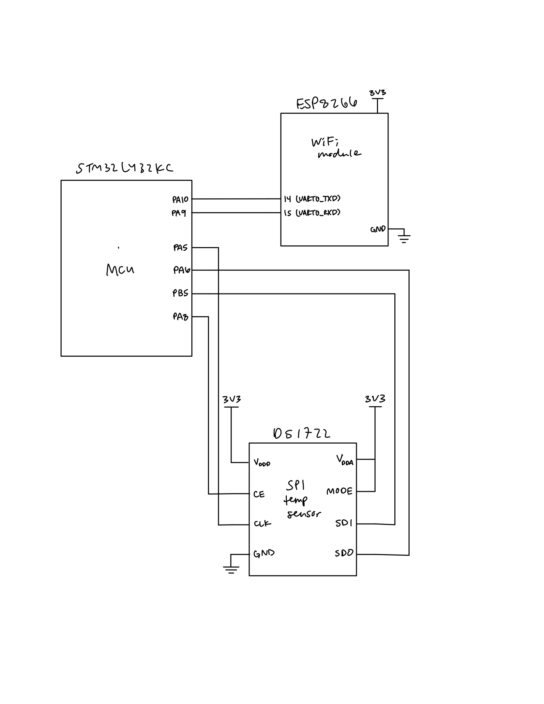
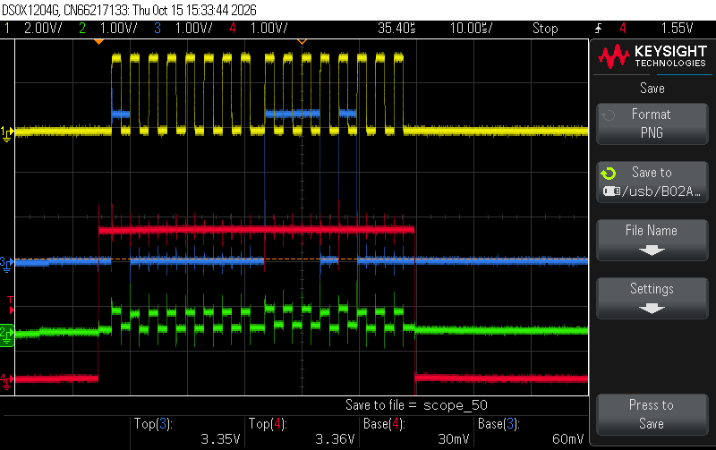
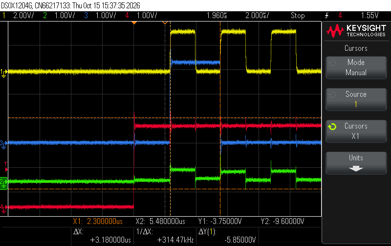
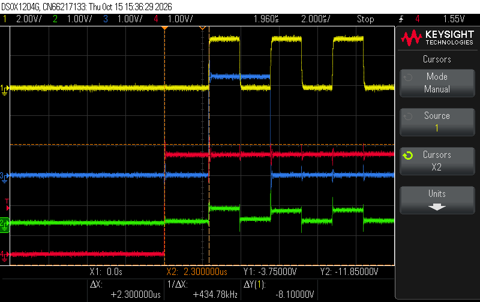
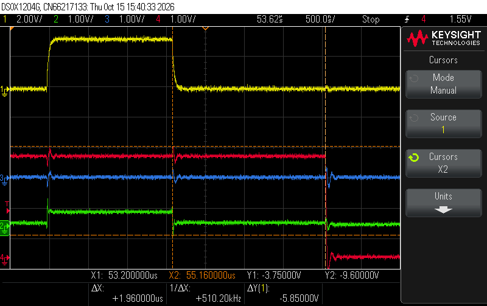
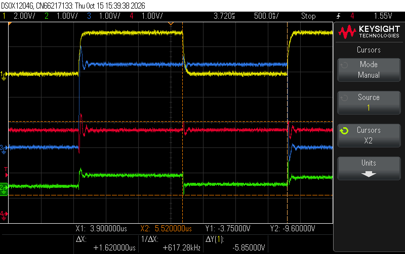

# Introduction

In this lab, I built an IoT device using the STM32L432KC MCU, a DS1722 digital temperature sensor, and an ESP8266 Wi-Fi module. I wrote an SPI driver using the CMSIS device templates and a DS1722 driver on top of it. The MCU reads the temperature over SPI and serves a webpage (through the ESP8266 over UART) that shows the current temperature, lets the user pick the sensor resolution (8 to 12 bits), and shows and toggles the on-board LED.

## Overall Design

<!-- TODO: block diagram / short description of how MCU, DS1722, and ESP8266 connect -->

- `main.c`: receives requests from the ESP8266 over USART1, updates LED and resolution, reads the temperature, and sends back the webpage
- `STM32L432KC_SPI.c/.h`: SPI1 master driver 
- `DS1722.c/.h`: DS1722 driver 

## SPI Driver

SPI1 is configured as master, 8-bit data, MSB first, full duplex, with software slave management. CE is driven manually on PA8 as a GPIO since the DS1722's CE is active high.

- Baud rate: `BR = 0b111` (f~PCLK~/256 = 80 MHz / 256 ≈ 312.5 kHz) <!-- TODO: confirm APB2 prescaler is 1 -->
- CPOL = 0, CPHA = 1 (the DS1722 latches data on the falling edge in this mode)

`spiSendReceive()` waits for TXE, writes one byte to `DR`, waits for RXNE, reads the received byte, then waits for BSY to clear so CE isn't dropped mid-transfer.

## DS1722 Driver

<!-- TODO: explain config register (111 1SHOT R2 R1 R0 SD), continuous mode, burst read 0x01 -> 0x02 -->

The temperature is read in one transaction: address `0x01`, then two dummy bytes to clock out the LSB and MSB. The two bytes form a 16-bit two's complement value with 8 fractional bits, so the temperature in °C is the signed value divided by 256.

After a resolution change, the driver waits the max conversion time for that resolution (75 / 150 / 300 / 600 / 1200 ms for 8–12 bits) before reading.

## Webpage

<!-- TODO: describe request parsing (ledon/ledoff, 8bit..12bit) and webpage contents -->

## Testing 

<!-- TODO: how you tested (config register readback, logic analyzer, comparing against room temp / touching sensor, etc.) -->

# Technical Documentation

## Code

<!-- TODO: link to GitHub repo -->

::: {.callout-note collapse="true"}
## SPI driver header (`STM32L432KC_SPI.h`)

```c
// STM32L432KC_SPI.h
// TODO: <YOUR NAME>
// TODO: <YOUR EMAIL>
// TODO: <DATE>
// TODO: <SHORT DESCRIPTION OF WHAT THIS FILE DOES>

#ifndef STM32L4_SPI_H
#define STM32L4_SPI_H

#include <stdint.h>
#include <stm32l432xx.h>

///////////////////////////////////////////////////////////////////////////////
// Function prototypes
///////////////////////////////////////////////////////////////////////////////

/* Enables the SPI peripheral and intializes its clock speed (baud rate), polarity, and phase.
 *    -- br: (0b000 - 0b111). The SPI clk will be the master clock / 2^(BR+1).
 *    -- cpol: clock polarity (0: inactive state is logical 0, 1: inactive state is logical 1).
 *    -- cpha: clock phase (0: data captured on leading edge of clk and changed on next edge, 
 *          1: data changed on leading edge of clk and captured on next edge)
 * Refer to the datasheet for more low-level details. */ 
void initSPI(int br, int cpol, int cpha);

/* Transmits a character (1 byte) over SPI and returns the received character.
 *    -- send: the character to send over SPI
 *    -- return: the character received over SPI */
char spiSendReceive(char send);

#endif
```
:::

::: {.callout-note collapse="true"}
## SPI driver (`STM32L432KC_SPI.c`)

```c
// STM32L432KC_SPI.c
// SPI1 master driver for STM32L432KC (matches the course-provided STM32L432KC_SPI.h)

#include "STM32L432KC_SPI.h"

void initSPI(int br, int cpol, int cpha) {
    // Make sure the SPI1 peripheral clock is on (APB2ENR.SPI1EN)
    RCC->APB2ENR |= RCC_APB2ENR_SPI1EN;

    // Disable SPI and start from a clean slate so re-init is safe
    SPI1->CR1 = 0;
    SPI1->CR2 = 0;

    // CR2: 8-bit data size, RXNE fires at 8 bits, Motorola frame format (FRF=0),
    // no hardware NSS output (SSOE=0), no NSS pulse (NSSP=0)
    SPI1->CR2 = _VAL2FLD(SPI_CR2_DS, 0b0111) | SPI_CR2_FRXTH;

    // CR1: baud rate, polarity, phase
    SPI1->CR1 |= _VAL2FLD(SPI_CR1_BR, br & 0x7);
    SPI1->CR1 |= _VAL2FLD(SPI_CR1_CPOL, cpol & 1);
    SPI1->CR1 |= _VAL2FLD(SPI_CR1_CPHA, cpha & 1);

    // MSB first, full duplex, 2-line (LSBFIRST, RXONLY, BIDIMODE already 0 from reset above)

    // Software slave management: internal NSS held high so master mode isn't faulted
    SPI1->CR1 |= SPI_CR1_SSM | SPI_CR1_SSI;

    // Master mode (after SSI is set)
    SPI1->CR1 |= SPI_CR1_MSTR;

    // Enable last
    SPI1->CR1 |= SPI_CR1_SPE;
}

char spiSendReceive(char send) {
    while (!(SPI1->SR & SPI_SR_TXE));                       // wait until TX buffer empty
    *(volatile uint8_t *)&SPI1->DR = (uint8_t)send;         // 8-bit write: one byte into the FIFO
    while (!(SPI1->SR & SPI_SR_RXNE));                      // wait for received byte
    uint8_t rx = *(volatile uint8_t *)&SPI1->DR;            // 8-bit read
    while (SPI1->SR & SPI_SR_BSY);                          // bus idle before caller drops CE
    return (char)rx;
}
```
:::

::: {.callout-note collapse="true"}
## DS1722 driver header (`DS1722.h`)

```c
// DS1722.h
// DS1722 digital thermometer driver (SPI mode, CE active high on PA8)

#ifndef DS1722_H
#define DS1722_H

#include <stdint.h>
#include "STM32L432KC.h"

#define DS1722_CE_PIN PA8

// Config bytes: 111 1SHOT R2 R1 R0 SD, with SD=0 (continuous), 1SHOT=0
#define DS1722_CFG_8BIT   0xE0
#define DS1722_CFG_9BIT   0xE2
#define DS1722_CFG_10BIT  0xE4
#define DS1722_CFG_11BIT  0xE6
#define DS1722_CFG_12BIT  0xE8

// Sets continuous conversion at 12-bit and waits for the first conversion.
void initTempSensor(void);

// Writes a config byte (0xE0..0xE8) and waits one full conversion time.
// Ignores bytes that aren't a valid resolution config (e.g. 0).
void writeToTempSensor(uint8_t cfg);

// Reads the config register (for checking the SPI link; expect what you wrote).
uint8_t readConfigFromTempSensor(void);

// Reads temperature registers and returns degrees C.
double readFromTempSensor(void);

// Converts raw {MSB, LSB} to degrees C (16-bit two's complement, /256).
double calc_temp(uint8_t hi, uint8_t lo);

#endif
```
:::

::: {.callout-note collapse="true"}
## DS1722 driver (`DS1722.c`)

```c
// DS1722.c
// DS1722 digital thermometer driver over SPI (CE active high on PA8)

#include "DS1722.h"

#define DS1722_ADDR_CFG_READ   0x00
#define DS1722_ADDR_CFG_WRITE  0x80
#define DS1722_ADDR_TEMP_LSB   0x01   // MSB at 0x02; burst read auto-advances 01h -> 02h

static void ceHigh(void) { digitalWrite(DS1722_CE_PIN, 1); }
static void ceLow(void)  { digitalWrite(DS1722_CE_PIN, 0); }

// Max conversion time in ms for a given config byte (datasheet Table 5)
static uint32_t conversionMs(uint8_t cfg) {
    if (cfg & 0x08) return 1200;                 // R2=1 -> 12-bit
    switch ((cfg >> 1) & 0x3) {                  // R1:R0
        case 0:  return 75;                      // 8-bit
        case 1:  return 150;                     // 9-bit
        case 2:  return 300;                     // 10-bit
        default: return 600;                     // 11-bit
    }
}

static void writeConfig(uint8_t cfg) {
    ceHigh();
    spiSendReceive(DS1722_ADDR_CFG_WRITE);
    spiSendReceive(cfg);
    ceLow();
}

void initTempSensor(void) {
    ceLow();
    writeConfig(DS1722_CFG_12BIT);               // powers up in shutdown; this clears SD
    delay_millis(TIM15, 1200);                   // let the first 12-bit conversion finish
}

void writeToTempSensor(uint8_t cfg) {
    // Accept only 111x xxx0 patterns with 1SHOT clear: 0xE0, E2, E4, E6, E8
    if ((cfg & 0xF1) != 0xE0 || ((cfg >> 1) & 0x7) > 4) return;

    writeConfig(cfg);
    delay_millis(TIM15, conversionMs(cfg));      // CE is already low while we wait
}

uint8_t readConfigFromTempSensor(void) {
    ceHigh();
    spiSendReceive(DS1722_ADDR_CFG_READ);
    uint8_t cfg = spiSendReceive(0x00);
    ceLow();
    return cfg;
}

double readFromTempSensor(void) {
    // One burst transaction: address 0x01, then LSB, then MSB (address auto-increments)
    ceHigh();
    spiSendReceive(DS1722_ADDR_TEMP_LSB);
    uint8_t lsb = spiSendReceive(0x00);
    uint8_t msb = spiSendReceive(0x00);
    ceLow();
    return calc_temp(msb, lsb);
}

double calc_temp(uint8_t hi, uint8_t lo) {
    // {hi, lo} is a 16-bit two's complement value with 8 fractional bits.
    // The signed cast handles negative temperatures.
    int16_t raw = (int16_t)(((uint16_t)hi << 8) | lo);
    return raw / 256.0;
}
```
:::

::: {.callout-note collapse="true"}
## Main header (`main.h`)

```c
/**
    Main Header: Contains general defines and selected portions of CMSIS files
    @file main.h
    @author Josh Brake
    @version 1.0 10/7/2020
*/

#ifndef MAIN_H
#define MAIN_H

#include "STM32L432KC.h"

#define LED_PIN PB3 // LED pin for blinking on Port B pin 3
#define BUFF_LEN 32

#endif // MAIN_H
```
:::

::: {.callout-note collapse="true"}
## Main program (`main.c`)

```c
/*
File: Lab_6_JHB.c
Author: Josh Brake
Email: jbrake@hmc.edu
Date: 9/14/19
*/

#include <string.h>
#include <stdlib.h>
#include <stdio.h>
#include "main.h"

/////////////////////////////////////////////////////////////////
// Web page pieces
/////////////////////////////////////////////////////////////////

char* webpageStart = "<!DOCTYPE html><html><head><title>DS1722 Temperature Sensor</title>\
	<meta name=\"viewport\" content=\"width=device-width, initial-scale=1.0\">\
	</head>\
	<body><h1>DS1722 Temperature Sensor</h1>";

char* resStr = "<h2>Resolution Control:</h2>\
	<form action=\"12bit\"><input type=\"submit\" value=\"12 bits\"></form>\
	<form action=\"11bit\"><input type=\"submit\" value=\"11 bits\"></form>\
	<form action=\"10bit\"><input type=\"submit\" value=\"10 bits\"></form>\
	<form action=\"9bit\"><input type=\"submit\" value=\"9 bits\"></form>\
	<form action=\"8bit\"><input type=\"submit\" value=\"8 bits\"></form>";

char* ledStr = "<h2>LED Control:</h2><form action=\"ledon\"><input type=\"submit\" value=\"Turn the LED on!\"></form>\
	<form action=\"ledoff\"><input type=\"submit\" value=\"Turn the LED off!\"></form>";

char* webpageEnd   = "</body></html>";

/////////////////////////////////////////////////////////////////
// Helpers
/////////////////////////////////////////////////////////////////

// Returns 1 if des appears in request, -1 if not
int inString(char request[], char des[]) {
	if (strstr(request, des) != NULL) {return 1;}
	return -1;
}

// LED state persists between requests; only ledon/ledoff change it
int updateLEDStatus(char request[])
{
	static int led_status = 0;

	if (inString(request, "ledoff") == 1) {
		digitalWrite(LED_PIN, PIO_LOW);
		led_status = 0;
	}
	else if (inString(request, "ledon") == 1) {
		digitalWrite(LED_PIN, PIO_HIGH);
		led_status = 1;
	}

	return led_status;
}

// Returns the DS1722 config byte for a resolution button, or 0 if the request isn't one
uint8_t updateResStatus(char request[])
{
	if (inString(request, "12bit") == 1) return DS1722_CFG_12BIT;
	if (inString(request, "11bit") == 1) return DS1722_CFG_11BIT;
	if (inString(request, "10bit") == 1) return DS1722_CFG_10BIT;
	if (inString(request, "9bit")  == 1) return DS1722_CFG_9BIT;
	if (inString(request, "8bit")  == 1) return DS1722_CFG_8BIT;
	return 0;
}

// Number of resolution bits for a config byte (R2 -> 12, else 8 + R1:R0)
int resBitsFromCfg(uint8_t cfg)
{
	if (cfg & 0x08) return 12;
	return 8 + ((cfg >> 1) & 0x3);
}

// Writes value / 10^decimals as text (e.g. 235625 with decimals=4 -> "23.5625") at p.
// Handles negatives and zero-padded fractions without using printf. Returns pointer past the end.
char* fmtFixed(char *p, int value, int decimals)
{
	int scale = 1;
	for (int i = 0; i < decimals; i++) scale *= 10;

	if (value < 0) { *p++ = '-'; value = -value; }
	int whole = value / scale;
	int frac  = value % scale;

	char tmp[12];
	int n = 0;
	if (whole == 0) tmp[n++] = '0';
	while (whole > 0) { tmp[n++] = '0' + (whole % 10); whole /= 10; }
	while (n > 0) *p++ = tmp[--n];

	if (decimals > 0) {
		*p++ = '.';
		int div = scale / 10;
		for (int i = 0; i < decimals; i++) { *p++ = '0' + (frac / div) % 10; div /= 10; }
	}
	*p = '\0';
	return p;
}

void configurePins(void)
{
	pinMode(PA5, GPIO_ALT);    // SPI1_SCK
	pinMode(PA6, GPIO_ALT);    // SPI1_MISO
	pinMode(PB5, GPIO_ALT);    // SPI1_MOSI
	pinMode(DS1722_CE_PIN, GPIO_OUTPUT); // DS1722 CE (active high)
	digitalWrite(DS1722_CE_PIN, 0);      // idle low

	// Very high output speed for SCK, MISO, MOSI (2 bits per pin: PA5 -> [11:10], PA6 -> [13:12], PB5 -> [11:10])
	GPIOA->OSPEEDR |= ((3 << 10) | (3 << 12));
	GPIOB->OSPEEDR |= (3 << 10);

	// AF5 = SPI1 on PA5 ([23:20]), PA6 ([27:24]) and PB5 ([23:20]) (AFRL, 4 bits per pin)
	GPIOA->AFR[0] &= ~((0xFU << 20) | (0xFU << 24));
	GPIOB->AFR[0] &= ~(0xFU << 20);
	GPIOA->AFR[0] |=  ((5U << 20) | (5U << 24));
	GPIOB->AFR[0] |=  (5U << 20);
}

/////////////////////////////////////////////////////////////////
// Main
/////////////////////////////////////////////////////////////////

int main(void) {
  configureFlash();
  configureClock();

  gpioEnable(GPIO_PORT_A);
  gpioEnable(GPIO_PORT_B);
  gpioEnable(GPIO_PORT_C);

  pinMode(LED_PIN, GPIO_OUTPUT);

  RCC->APB2ENR |= (RCC_APB2ENR_TIM15EN);
  initTIM(TIM15);

  USART_TypeDef * USART = initUSART(USART1_ID, 125000);

  // SPI: pins first, then the peripheral (initSPI also enables the SPI1 clock)
  configurePins();
  initSPI(0b111, 0, 1);   // slowest clock (PCLK/256), CPOL=0, CPHA=1 as the DS1722 requires

  initTempSensor();       // 12-bit continuous; waits for the first conversion
  int resBits = 12;

  while(1) {
    /* Wait for ESP8266 to send a request.
    Requests take the form of '/REQ:<tag>\n', with TAG begin <= 10 characters.
    */

    // Receive web request from the ESP
    char request[BUFF_LEN] = "                  "; // initialize to known value
    int charIndex = 0;

    // Keep going until you get end of line character
    while(inString(request, "\n") == -1) {
      // Wait for a complete request to be transmitted before processing
      while(!(USART->ISR & USART_ISR_RXNE));
      char c = readChar(USART);
      if (charIndex < BUFF_LEN - 1) request[charIndex++] = c;  // don't overflow the buffer
    }

    // Change resolution only if a resolution button was pressed
    uint8_t cfg = updateResStatus(request);
    if (cfg) {
      writeToTempSensor(cfg);        // waits one full conversion at the new resolution
      resBits = resBitsFromCfg(cfg);
    }

    // Read temperature and format it without needing printf float support
    double temp = readFromTempSensor();
    int tenThousandths = (int)(temp * 10000.0 + (temp >= 0 ? 0.5 : -0.5));
    double tempF = temp * 9.0 / 5.0 + 32.0;
    int hundredthsF = (int)(tempF * 100.0 + (tempF >= 0 ? 0.5 : -0.5));
    char tempStatusStr[96];
    char *p = tempStatusStr;
    strcpy(p, "Temperature: ");  p += strlen(p);
    p = fmtFixed(p, tenThousandths, 4);
    strcpy(p, " C / ");          p += strlen(p);
    p = fmtFixed(p, hundredthsF, 2);
    strcpy(p, " F (");           p += strlen(p);
    p = fmtFixed(p, resBits, 0);
    strcpy(p, "-bit)");

    // Update string with current LED state
    int led_status = updateLEDStatus(request);

    char ledStatusStr[20];
    if (led_status == 1)
      sprintf(ledStatusStr, "LED is on!");
    else
      sprintf(ledStatusStr, "LED is off!");

    // finally, transmit the webpage over UART
    sendString(USART, webpageStart);

    sendString(USART, "<h2>Temperature</h2><p>");
    sendString(USART, tempStatusStr);
    sendString(USART, "</p>");
    sendString(USART, resStr);

    sendString(USART, ledStr);
    sendString(USART, "<h2>LED Status</h2><p>");
    sendString(USART, ledStatusStr);
    sendString(USART, "</p>");

    sendString(USART, webpageEnd);
  }
}
```
:::

## Pin Assignments

| Signal | MCU Pin | Connected To |
|---|---|---|
| SPI1_SCK | PA5 | DS1722 SCLK |
| SPI1_MISO | PA6 | DS1722 SDO |
| SPI1_MOSI | PB5 | DS1722 SDI |
| CE (GPIO) | PA8 | DS1722 CE |
| USART1_TX | PA9 | ESP8266 RX |
| USART1_RX | PA10 | ESP8266 TX |
| LED | PB3 | On-board LED |

<!-- TODO: DS1722 pin numbers, SERMODE tied to VDD for SPI, power pins -->

## Hardware Schematic

{width=100%}

The on-board components (MCU, LED, etc.) are shown in the [E155 development board schematic](TODO-link).

# Results

## Logic Analyzer

Channels: 1 (yellow) = SCK, 2 (green) = SDO (MCU MISO), 3 (blue) = SDI (MCU MOSI), 4 (red) = CE.

{width=100%}

## SPI Timing vs. Datasheet

| Parameter | Datasheet | Measured | Capture |
|---|---|---|---|
| SCLK period / frequency | ≥ 200 ns (≤ 5 MHz) | 3.18 µs (≈ 314 kHz) | `clk-period.png` |
| CE to SCLK setup | TODO | 2.30 µs | `ce-setup-time.png` |
| SCLK to CE hold | TODO | 1.96 µs | `ce-hold-time.png` |
| Data change to SCLK sampling edge | TODO | 1.62 µs | `data-change.png` |

::: {.callout-note collapse="true"}
## SCLK period

{width=100%}
:::

::: {.callout-note collapse="true"}
## CE setup time

{width=100%}
:::

::: {.callout-note collapse="true"}
## CE hold time

{width=100%}
:::

::: {.callout-note collapse="true"}
## Data change vs. sampling edge

{width=100%}
:::

## Webpage

::: {.callout-note collapse="true"}
## Webpage screenshot

<!-- {width=100%} -->
:::

## Resolution and Temperature Range

<!-- TODO: explain that the 16-bit two's complement format covers -10 °C to 30 °C at all resolutions; note which resolution you default to and why -->

## Issues and Debugging

<!-- TODO -->

# Requirements Checklist

| Requirement | Met? |
|---|---|
| DS1722 wired per datasheet | |
| ESP8266 wired at 3.3 V, TX/RX crossed | |
| FPGA disconnected (DIP switches open) | |
| Webpage shows temperature, updates on refresh | |
| Webpage shows and toggles LED state | |
| Resolution selectable from webpage (8–12 bit) | |
| SPI driver uses CMSIS device templates | |
| Resolution supports -10 °C to 30 °C | |
| Labeled logic analyzer capture of SPI read | |
| Capture annotated with datasheet timing | |
| Schematic meets spec | |

<!-- TODO: statement of whether design meets all requirements; list any shortcomings -->

# AI Prototype and Reflection

## AI Prototype

<!-- TODO: prompt used and what it produced -->

## Reflection

<!-- TODO -->

# Hours Spent

<!-- TODO: X hours -->

# Comments and Suggestions

<!-- TODO (optional) -->
