# Introduction

In this lab, I built an IoT device using the STM32L432KC MCU, a DS1722 digital temperature sensor, and an ESP8266 Wi-Fi module. I wrote an SPI driver using the CMSIS device templates and a DS1722 driver on top of it. The MCU reads the temperature over SPI and serves a webpage (through the ESP8266 over UART) that shows the current temperature, lets the user pick the sensor resolution (8 to 12 bits), and shows and toggles the on-board LED.

## Overall Design

The ESP8266 hosts a Wi-Fi access point and web server. When a browser opens `http://192.168.4.1/` or clicks a button, the ESP8266 forwards the request to the MCU over UART at 125000 baud as `/REQ:<tag>\n`. The MCU checks the tag and updates the LED or the DS1722 resolution. It then reads the temperature from the DS1722 over SPI and sends the whole HTML page back to the ESP8266, which passes it to the browser.

- `main.c`: receives requests from the ESP8266 over USART1, updates LED and resolution, reads the temperature, and sends back the webpage
- `STM32L432KC_SPI.c/.h`: SPI1 master driver 
- `DS1722.c/.h`: DS1722 driver 

## SPI Driver

SPI1 is configured as master, 8-bit data, MSB first, and full duplex. CE is driven manually on PA8 as a GPIO since the DS1722's CE is active high.

- Baud rate: `BR = 0b111` (f~PCLK~/256 = 80 MHz / 256 ≈ 312.5 kHz) 
- CPOL = 0, CPHA = 1 (the DS1722 latches data on the falling edge in this mode)

`spiSendReceive()` waits until the SPI transmit buffer has room, writes the byte to send into the data register, waits until a byte has been received, and reads it back. It then waits until the SPI bus is no longer busy, so the caller doesn't lower CE before the last bit has finished transferring.

## DS1722 Driver

<!-- TODO: explain config register (111 1SHOT R2 R1 R0 SD), continuous mode, burst read 0x01 -> 0x02 -->

Every DS1722 transaction starts with the MCU raising CE and sending an address byte over MOSI (DS1722 SDI). The address says which register to access, and its MSB selects read (0) or write (1). For a read, the DS1722 starts driving that register's contents onto MISO (or SDO) after the 8 address clock cycles. Because SPI is full duplex, the MCU has to keep clocking to receive data, so it sends dummy `0x00` bytes on MOSI and reads what comes back on MISO.

The temperature is read in one SPI transaction which consists of the MCU sending the temperature address `0x01`, then two dummy bytes. During the first dummy byte the DS1722 sends the LSB. The address then iterates to `0x02` automatically, so the MSB comes back during the second dummy byte. The two bytes form a 16-bit two's complement value with 8 fractional bits, so the temperature in °C is the signed value divided by 256.

After the resolution changes, the driver waits the max conversion time for that resolution (75 / 150 / 300 / 600 / 1200 ms for 8–12 bits) before reading anything.

# Technical Documentation

## Code

::: {.callout-note collapse="true"}
## SPI driver header (`STM32L432KC_SPI.h`)

```c
// STM32L432KC_SPI.h

#ifndef STM32L4_SPI_H
#define STM32L4_SPI_H

#include <stdint.h>
#include <stm32l432xx.h>

///////////////////////////////////////////////////////////////////////////////
// Function prototypes
///////////////////////////////////////////////////////////////////////////////

/* Enables the SPI peripheral and intializes its clock speed (baud rate), polarity, and phase.
 *    -- br: (0b000 - 0b111). The SPI clk will be the master clock / 2^(BR+1).
 *    -- cpol: clock polarity (0: inactive state is logical 0, 1: inactive state is logical 1).
 *    -- cpha: clock phase (0: data captured on leading edge of clk and changed on next edge, 
 *          1: data changed on leading edge of clk and captured on next edge)
 * Refer to the datasheet for more low-level details. */ 
void initSPI(int br, int cpol, int cpha);

/* Transmits a character (1 byte) over SPI and returns the received character.
 *    -- send: the character to send over SPI
 *    -- return: the character received over SPI */
char spiSendReceive(char send);

#endif
```
:::

::: {.callout-note collapse="true"}
## SPI driver (`STM32L432KC_SPI.c`)

```c
// STM32L432KC_SPI.c
// SPI1 master driver for STM32L432KC 

#include "STM32L432KC_SPI.h"

void initSPI(int br, int cpol, int cpha) {
    // Make sure the SPI1 peripheral clock is on (APB2ENR.SPI1EN)
    RCC->APB2ENR |= RCC_APB2ENR_SPI1EN;

    // Disable SPI and start from a clean slate so re-init is safe
    SPI1->CR1 = 0;
    SPI1->CR2 = 0;

    // CR2: 8-bit data size, RXNE fires at 8 bits, Motorola frame format (FRF=0),
    // no hardware NSS output (SSOE=0), no NSS pulse (NSSP=0)
    SPI1->CR2 = _VAL2FLD(SPI_CR2_DS, 0b0111) | SPI_CR2_FRXTH;

    // CR1: baud rate, polarity, phase
    SPI1->CR1 |= _VAL2FLD(SPI_CR1_BR, br & 0x7);
    SPI1->CR1 |= _VAL2FLD(SPI_CR1_CPOL, cpol & 1);
    SPI1->CR1 |= _VAL2FLD(SPI_CR1_CPHA, cpha & 1);

    // MSB first, full duplex, 2-line (LSBFIRST, RXONLY, BIDIMODE already 0 from reset above)

    // Software slave management: internal NSS held high so master mode isn't faulted
    SPI1->CR1 |= SPI_CR1_SSM | SPI_CR1_SSI;

    // Master mode (after SSI is set)
    SPI1->CR1 |= SPI_CR1_MSTR;

    // Enable last
    SPI1->CR1 |= SPI_CR1_SPE;
}

char spiSendReceive(char send) {
    while (!(SPI1->SR & SPI_SR_TXE));                       // wait until TX buffer empty
    *(volatile uint8_t *)&SPI1->DR = (uint8_t)send;         // 8-bit write: one byte into the FIFO
    while (!(SPI1->SR & SPI_SR_RXNE));                      // wait for received byte
    uint8_t rx = *(volatile uint8_t *)&SPI1->DR;            // 8-bit read
    while (SPI1->SR & SPI_SR_BSY);                          // bus idle before caller drops CE
    return (char)rx;
}
```
:::

::: {.callout-note collapse="true"}
## DS1722 driver header (`DS1722.h`)

```c
// DS1722.h
// DS1722 digital thermometer driver (SPI mode, CE active high on PA8)

#ifndef DS1722_H
#define DS1722_H

#include <stdint.h>
#include "STM32L432KC.h"

#define DS1722_CE_PIN PA8

// Config bytes: 111 1SHOT R2 R1 R0 SD, with SD=0 (continuous), 1SHOT=0
#define DS1722_CFG_8BIT   0xE0
#define DS1722_CFG_9BIT   0xE2
#define DS1722_CFG_10BIT  0xE4
#define DS1722_CFG_11BIT  0xE6
#define DS1722_CFG_12BIT  0xE8

// Sets continuous conversion at 12-bit and waits for the first conversion
void initTempSensor(void);

// Writes a config byte (0xE0..0xE8) and waits one full conversion time.
// Ignores bytes that aren't a valid resolution config (e.g. 0)
void writeToTempSensor(uint8_t cfg);

// Reads the config register (for checking the SPI link; expect what you wrote)
uint8_t readConfigFromTempSensor(void);

// Reads temperature registers and returns degrees C
double readFromTempSensor(void);

// Converts raw {MSB, LSB} to degrees C (16-bit two's complement, /256)
double calcTemp(uint8_t hi, uint8_t lo);

#endif
```
:::

::: {.callout-note collapse="true"}
## DS1722 driver (`DS1722.c`)

```c
// DS1722.c
// DS1722 digital thermometer driver over SPI (CE active high on PA8)

#include "DS1722.h"

#define DS1722_ADDR_CFG_READ   0x00
#define DS1722_ADDR_CFG_WRITE  0x80
#define DS1722_ADDR_TEMP_LSB   0x01   // MSB at 0x02; burst read auto-advances 01h -> 02h

static void ceHigh(void) { digitalWrite(DS1722_CE_PIN, 1); }
static void ceLow(void)  { digitalWrite(DS1722_CE_PIN, 0); }

// Max conversion time in ms for a given config byte (datasheet Table 5)
static uint32_t conversionMs(uint8_t cfg) {
    if (cfg & 0x08) return 1200;                 // R2=1 -> 12-bit
    switch ((cfg >> 1) & 0x3) {                  // R1:R0
        case 0:  return 75;                      // 8-bit
        case 1:  return 150;                     // 9-bit
        case 2:  return 300;                     // 10-bit
        default: return 600;                     // 11-bit
    }
}

static void writeConfig(uint8_t cfg) {
    ceHigh();
    spiSendReceive(DS1722_ADDR_CFG_WRITE);
    spiSendReceive(cfg);
    ceLow();
}

void initTempSensor(void) {
    ceLow();
    writeConfig(DS1722_CFG_12BIT);               // powers up in shutdown; clears SD
    delay_millis(TIM15, 1200);                   // let the first 12-bit conversion finish
}

void writeToTempSensor(uint8_t cfg) {
    // Accept only 111x xxx0 patterns with 1SHOT clear: 0xE0, E2, E4, E6, E8
    if ((cfg & 0xF1) != 0xE0 || ((cfg >> 1) & 0x7) > 4) return;

    writeConfig(cfg);
    delay_millis(TIM15, conversionMs(cfg));      // CE is already low while we wait
}

uint8_t readConfigFromTempSensor(void) {
    ceHigh();
    spiSendReceive(DS1722_ADDR_CFG_READ);
    uint8_t cfg = spiSendReceive(0x00);
    ceLow();
    return cfg;
}

double readFromTempSensor(void) {
    // One transaction, address 0x01, then LSB, then MSB (address auto-increments)
    ceHigh();
    spiSendReceive(DS1722_ADDR_TEMP_LSB);
    uint8_t lsb = spiSendReceive(0x00);
    uint8_t msb = spiSendReceive(0x00);
    ceLow();
    return calcTemp(msb, lsb);
}

double calcTemp(uint8_t hi, uint8_t lo) {
    // {hi, lo} is a 16-bit two's complement value with 8 fractional bits.
    // The signed cast handles negative temperatures.
    int16_t raw = (int16_t)(((uint16_t)hi << 8) | lo);
    return raw / 256.0;
}
```
:::

::: {.callout-note collapse="true"}
## Main header (`main.h`)

```c
/**
    Main Header: Contains general defines and selected portions of CMSIS files
    @file main.h
    @author Josh Brake
    @version 1.0 10/7/2020
*/

#ifndef MAIN_H
#define MAIN_H

#include "STM32L432KC.h"
#include "STM32L432KC_SPI.h"
#include "DS1722.h"

#define LED_PIN PB3 // LED pin for blinking on Port B pin 3
#define BUFF_LEN 32

#endif // MAIN_H
```
:::

::: {.callout-note collapse="true"}
## Main program (`main.c`)

```c
/*
main.c
*/

#include <string.h>
#include <stdlib.h>
#include <stdio.h>
#include "main.h"

char* webpageStart = "<!DOCTYPE html><html><head><title>DS1722 Temperature Sensor</title>\
	<meta name=\"viewport\" content=\"width=device-width, initial-scale=1.0\">\
	</head>\
	<body><h1>DS1722 Temperature Sensor</h1>";

char* resStr = "<h2>Resolution Control:</h2>\
	<form action=\"12bit\"><input type=\"submit\" value=\"12 bits\"></form>\
	<form action=\"11bit\"><input type=\"submit\" value=\"11 bits\"></form>\
	<form action=\"10bit\"><input type=\"submit\" value=\"10 bits\"></form>\
	<form action=\"9bit\"><input type=\"submit\" value=\"9 bits\"></form>\
	<form action=\"8bit\"><input type=\"submit\" value=\"8 bits\"></form>";

char* ledStr = "<h2>LED Control:</h2><form action=\"ledon\"><input type=\"submit\" value=\"Turn the LED on!\"></form>\
	<form action=\"ledoff\"><input type=\"submit\" value=\"Turn the LED off!\"></form>";

char* webpageEnd   = "</body></html>";

// Returns 1 if des appears in request, -1 if not
int inString(char request[], char des[]) {
	if (strstr(request, des) != NULL) {return 1;}
	return -1;
}

// LED state stays between requests; only ledon/ledoff change it
int updateLEDStatus(char request[])
{
	static int led_status = 0;

	if (inString(request, "ledoff") == 1) {
		digitalWrite(LED_PIN, PIO_LOW);
		led_status = 0;
	}
	else if (inString(request, "ledon") == 1) {
		digitalWrite(LED_PIN, PIO_HIGH);
		led_status = 1;
	}

	return led_status;
}

// Returns the DS1722 config byte for a resolution button, or 0 if the request isn't one
uint8_t updateResStatus(char request[])
{
	if (inString(request, "12bit") == 1) return DS1722_CFG_12BIT;
	if (inString(request, "11bit") == 1) return DS1722_CFG_11BIT;
	if (inString(request, "10bit") == 1) return DS1722_CFG_10BIT;
	if (inString(request, "9bit")  == 1) return DS1722_CFG_9BIT;
	if (inString(request, "8bit")  == 1) return DS1722_CFG_8BIT;
	return 0;
}

// Number of resolution bits for a config byte (R2 -> 12, else 8 + R1:R0)
int resBitsFromCfg(uint8_t cfg)
{
	if (cfg & 0x08) return 12;
	return 8 + ((cfg >> 1) & 0x3);
}

// Writes value / 10^decimals as text (e.g. 235625 with decimals=4 -> "23.5625") at p.
// Handles negatives and zero-padded fractions without using printf. Returns pointer past the end.
char* fmtFixed(char *p, int value, int decimals)
{
	int scale = 1;
	for (int i = 0; i < decimals; i++) scale *= 10;

	if (value < 0) { *p++ = '-'; value = -value; }
	int whole = value / scale;
	int frac  = value % scale;

	char tmp[12];
	int n = 0;
	if (whole == 0) tmp[n++] = '0';
	while (whole > 0) { tmp[n++] = '0' + (whole % 10); whole /= 10; }
	while (n > 0) *p++ = tmp[--n];

	if (decimals > 0) {
		*p++ = '.';
		int div = scale / 10;
		for (int i = 0; i < decimals; i++) { *p++ = '0' + (frac / div) % 10; div /= 10; }
	}
	*p = '\0';
	return p;
}

void configurePins(void)
{
	pinMode(PA5, GPIO_ALT);    // SPI1_SCK
	pinMode(PA6, GPIO_ALT);    // SPI1_MISO
	pinMode(PB5, GPIO_ALT);    // SPI1_MOSI
	pinMode(DS1722_CE_PIN, GPIO_OUTPUT); // DS1722 CE (active high)
	digitalWrite(DS1722_CE_PIN, 0);      // idle low

	// Very high output speed for SCK, MISO, MOSI (2 bits per pin: PA5 -> [11:10], PA6 -> [13:12], PB5 -> [11:10])
	GPIOA->OSPEEDR |= ((3 << 10) | (3 << 12));
	GPIOB->OSPEEDR |= (3 << 10);

	// AF5 = SPI1 on PA5 ([23:20]), PA6 ([27:24]) and PB5 ([23:20]) (AFRL, 4 bits per pin)
	GPIOA->AFR[0] &= ~((0xFU << 20) | (0xFU << 24));
	GPIOB->AFR[0] &= ~(0xFU << 20);
	GPIOA->AFR[0] |=  ((5U << 20) | (5U << 24));
	GPIOB->AFR[0] |=  (5U << 20);
}

int main(void) {
  configureFlash();
  configureClock();

  gpioEnable(GPIO_PORT_A);
  gpioEnable(GPIO_PORT_B);
  gpioEnable(GPIO_PORT_C);

  pinMode(LED_PIN, GPIO_OUTPUT);

  RCC->APB2ENR |= (RCC_APB2ENR_TIM15EN);
  initTIM(TIM15);

  USART_TypeDef * USART = initUSART(USART1_ID, 125000);

  // SPI: pins first, then the peripheral (initSPI also enables the SPI1 clock)
  configurePins();
  initSPI(0b111, 0, 1);   // slowest mcu clock (PCLK/256), CPOL=0, CPHA=1 as the DS1722 requires

  initTempSensor();       // 12-bit continuous; waits for the first conversion
  int resBits = 12;


  while(1) {
    /* Wait for ESP8266 to send a request.
    Requests take the form of '/REQ:<tag>\n', with TAG begin <= 10 characters.
    */

    // Receive web request from the ESP
    char request[BUFF_LEN] = "                  "; // initialize to known value
    int charIndex = 0;

    // Keep going until you get end of line character
    while(inString(request, "\n") == -1) {
      // Wait for a complete request to be transmitted before processing
      while(!(USART->ISR & USART_ISR_RXNE));
      char c = readChar(USART);
      if (charIndex < BUFF_LEN - 1) request[charIndex++] = c;  // don't overflow the buffer
    }

    // Change resolution only if a resolution button was pressed
    uint8_t cfg = updateResStatus(request);
    if (cfg) {
      writeToTempSensor(cfg);        // waits one full conversion at the new resolution
      resBits = resBitsFromCfg(cfg);
    }

    // Read temperature and format it, no printf styff
    double temp = readFromTempSensor();
    int tenThousandths = (int)(temp * 10000.0 + (temp >= 0 ? 0.5 : -0.5));
    double tempF = temp * 9.0 / 5.0 + 32.0;
    int hundredthsF = (int)(tempF * 100.0 + (tempF >= 0 ? 0.5 : -0.5));
    char tempStatusStr[96];
    char *p = tempStatusStr;
    strcpy(p, "Temperature: ");  p += strlen(p);
    p = fmtFixed(p, tenThousandths, 4);
    strcpy(p, " C / ");          p += strlen(p);
    p = fmtFixed(p, hundredthsF, 2);
    strcpy(p, " F (");           p += strlen(p);
    p = fmtFixed(p, resBits, 0);
    strcpy(p, "-bit)");

    // Update string with current LED state
    int led_status = updateLEDStatus(request);

    char ledStatusStr[20];
    if (led_status == 1)
      sprintf(ledStatusStr, "LED is on!");
    else
      sprintf(ledStatusStr, "LED is off!");

    // transmit webpage over UART
    sendString(USART, webpageStart);

    sendString(USART, "<h2>Temperature</h2><p>");
    sendString(USART, tempStatusStr);
    sendString(USART, "</p>");
    sendString(USART, resStr);

    sendString(USART, ledStr);
    sendString(USART, "<h2>LED Status</h2><p>");
    sendString(USART, ledStatusStr);
    sendString(USART, "</p>");

    sendString(USART, webpageEnd);
  }
}
```
:::

## Pin Assignments

| Signal | MCU Pin | Connected To |
|---|---|---|
| SPI1_SCK | PA5 | DS1722 SCLK |
| SPI1_MISO | PA6 | DS1722 SDO |
| SPI1_MOSI | PB5 | DS1722 SDI |
| CE (GPIO) | PA8 | DS1722 CE |
| USART1_TX | PA9 | ESP8266 RX |
| USART1_RX | PA10 | ESP8266 TX |
| LED | PB3 | On-board LED |

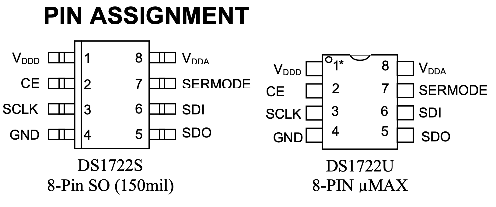{width=70%}
:::


## Hardware Schematic

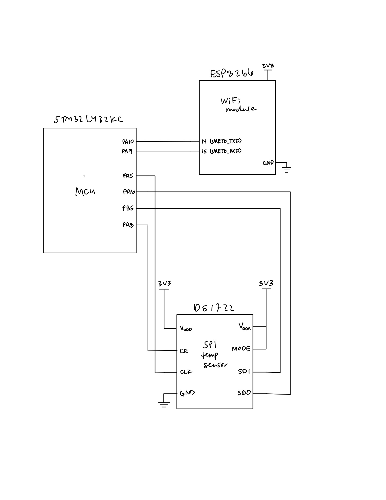{width=100%}

Stuff not added by me: The STM32L432KC is on the E155 dev board , and the LED on PB3 is on board the Nucleo. The FPGA on the motherboard is disconnected from the MCU by opening its DIP switches. These are shown in the [E155 Development Board Schematic](https://hmc-e155.github.io/assets/doc/E155%20Development%20Board%20Schematic.pdf). The DS1722 and ESP8266 wiring shown above is what I added.


# Results

## Logic Analyzer

Channels: 1 (yellow) = SCK, 2 (green) = SDO (MCU MISO), 3 (blue) = SDI (MCU MOSI), 4 (red) = CE.

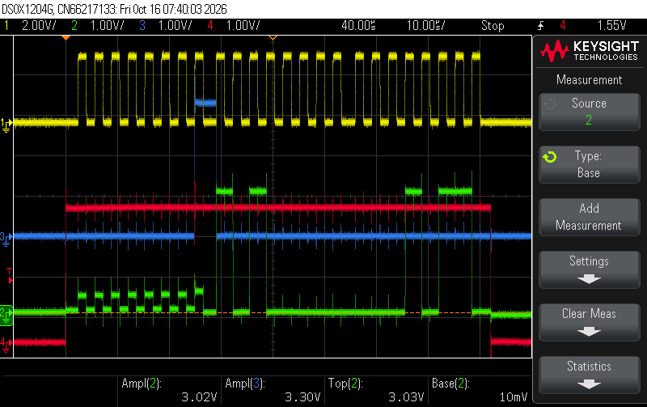{width=100%}

The capture shows three bytes (24 SCK cycles) inside one CE high window.

- **Byte 1:** the MCU sends read address `0x01` on SDI. 
- **Bytes 2 and 3:** SDI sends dummy `0x00` bytes while the DS1722 drives the temperature LSB and MSB on SDO.
- The DS1722 moves from register `0x01` to `0x02` after each byte, so one address byte is enough to get both halves of the temperature.

Byte 2 is `10100000` = `0xA0`, which is 0.625 °C. 
Byte 3 is about `0x16` = 22 °C, the integer part. 
Together that is about 22.6 °C which is reasonable room temperature and matches the 22.625 °C/72.725 °F I saw on the webpage.

## SPI Timing vs. Datasheet

I compared the captures against the DS1722 SPI timing diagrams and the AC Electrical Characteristics: SPI Interface table, measuring each interval with the scope cursors. Data changes on the SCK rising edge and is sampled on the falling edge.

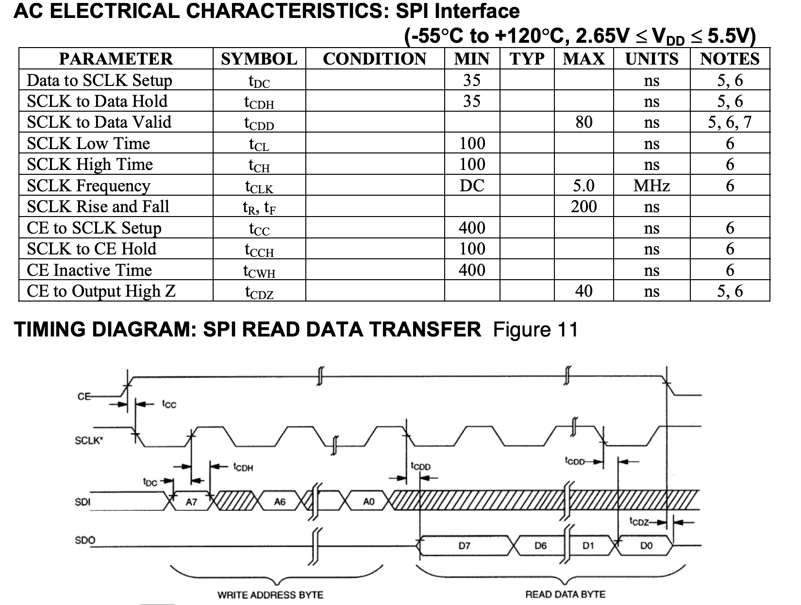{width=100%}

| Parameter | Symbol | Datasheet | Measured | Result |
|---|---|---|---|---|
| SCLK frequency | t~CLK~ | ≤ 5 MHz | 314.47 kHz (3.22 µs period) | Pass |
| SCLK rise / fall time | t~R~, t~F~ | ≤ 200 ns | 48 ns / 46 ns | Pass |
| CE to SCLK setup | t~CC~ | ≥ 400 ns | 2.42 µs | Pass |
| SCLK low time | t~CL~ | ≥ 100 ns | 1.60 µs | Pass |
| SCLK high time | t~CH~ | ≥ 100 ns | 1.62 µs | Pass |
| Data to SCLK setup | t~DC~ | ≥ 35 ns | ≈ 1.60 µs | Pass |
| SCLK to data hold | t~CDH~ | ≥ 35 ns | ≈ 1.62 µs | Pass |
| SCLK to data valid | t~CDD~ | ≤ 80 ns | 23 ns | Pass |
| SCLK to CE hold | t~CCH~ | ≥ 100 ns | 2.04 µs | Pass |

All measured timings meet the datasheet by a good margin because the SPI clock is slow (f~PCLK~/256) and each bit is held longer.

::: {.callout-note collapse="true"}
## SCLK period

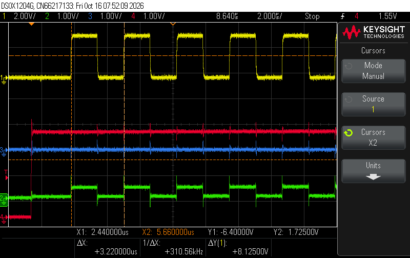{width=100%}
:::

::: {.callout-note collapse="true"}
## SCLK high time

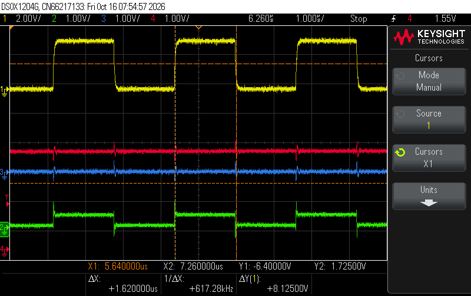{width=100%}
:::

::: {.callout-note collapse="true"}
## SCLK low time

{width=100%}
:::

::: {.callout-note collapse="true"}
## SCLK rise and fall time

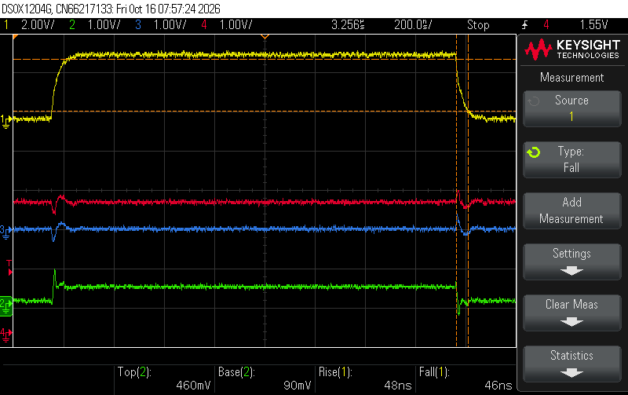{width=100%}
:::

::: {.callout-note collapse="true"}
## CE setup time

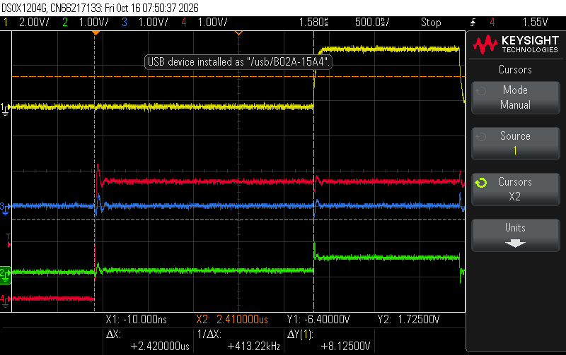{width=100%}
:::

::: {.callout-note collapse="true"}
## CE hold time

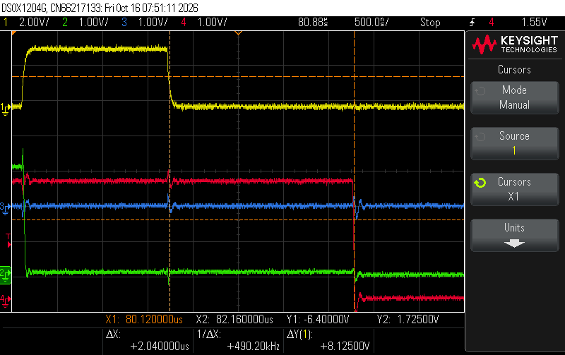{width=100%}
:::

::: {.callout-note collapse="true"}
## SCLK to data valid

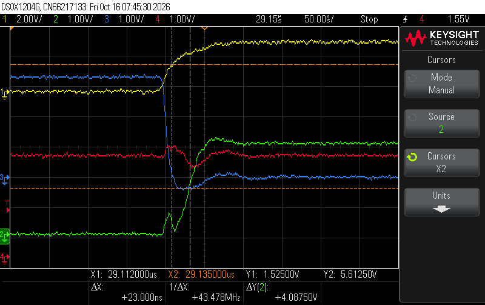{width=100%}
:::

## Webpage

::: {.callout-note collapse="true"}
## Webpage screenshot

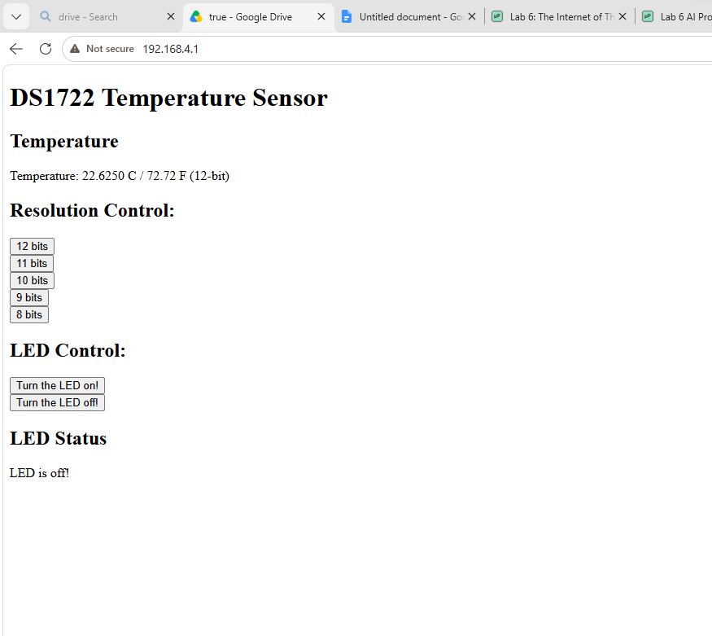{width=100%}
:::

## Resolution and Temperature Range

The DS1722 reports temperature as a 16-bit two's complement value with 8 fractional bits (raw / 256), so the format is the same at every resolution and easily covers the -10 °C to 30 °C test range. Changing the resolution only changes how many fractional bits are valid (from 1 °C at 8-bit down to 0.0625 °C at 12-bit) and the conversion time (75 ms to 1.2 s). My code defaults to 12-bit in `initTempSensor()` because it gives the finest resolution, and having slower conversion doesn't really matter since the webpage is refreshed by hand.

# Requirements Checklist

Yes, the design meets the requirements of the lab.

# AI Prototype and Reflection

## AI Prototype

### Webpage

I asked ChatGPT to make the webpage. It gave me a polished "Thermo" dashboard as a standalone HTML file, but it didn't help me with my project:

- Doesnt talk to the MCU 
- I didn't know how to get from that HTML file to a page my MCU could actually serve. When I asked Claude, the answer said I needed a conversion script, new firmware code and rewritten JavaScript.
- It overcomplicated the display with min/max, unit and precision selectors and an LED switch. An intuitive UI really only needs the temperature reading, so I kept my simple HTML-form page.

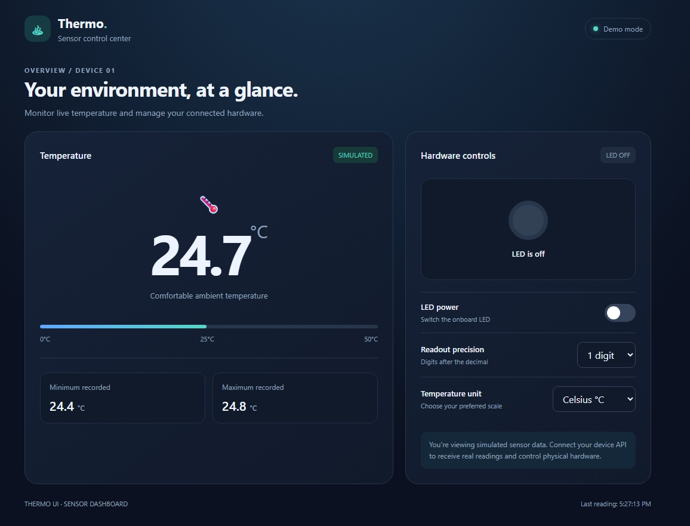{width=100%}

::: {.callout-note collapse="true"}
## AI-generated HTML (`index.html`)

```html
<!DOCTYPE html>
<html lang="en">
<head>
  <meta charset="UTF-8" />
  <meta name="viewport" content="width=device-width, initial-scale=1.0" />
  <title>Thermo | Sensor Dashboard</title>
  <style>
    :root {
      --bg: #0b1120;
      --panel: #131d30;
      --panel-light: #19263c;
      --border: #283750;
      --text: #edf3ff;
      --muted: #92a3bd;
      --accent: #56d6c4;
      --blue: #80aaff;
      --danger: #ff7c85;
    }

    * { box-sizing: border-box; }

    body {
      margin: 0;
      min-height: 100vh;
      background:
        radial-gradient(ellipse at 50% -20%, #1b3650 0%, transparent 60%),
        var(--bg);
      color: var(--text);
      font-family: Inter, ui-sans-serif, system-ui, -apple-system,
                   BlinkMacSystemFont, "Segoe UI", sans-serif;
    }

    button, select { font: inherit; }

    .container {
      width: min(1050px, 92%);
      margin: auto;
      padding: 34px 0 48px;
    }

    header {
      display: flex;
      justify-content: space-between;
      align-items: center;
      gap: 20px;
      margin-bottom: 38px;
    }

    .brand {
      display: flex;
      align-items: center;
      gap: 12px;
    }

    .brand-icon {
      display: grid;
      place-items: center;
      width: 44px;
      height: 44px;
      border-radius: 14px;
      background: #173b43;
      color: var(--accent);
      font-size: 24px;
    }

    h1, h2, p { margin-top: 0; }
    h1 { font-size: 21px; margin-bottom: 3px; }
    .subtitle, .muted { color: var(--muted); }
    .subtitle { font-size: 13px; margin: 0; }

    .connection {
      display: inline-flex;
      align-items: center;
      gap: 9px;
      padding: 9px 13px;
      border: 1px solid var(--border);
      border-radius: 99px;
      color: var(--muted);
      font-size: 12px;
      white-space: nowrap;
    }

    .dot {
      width: 8px;
      height: 8px;
      border-radius: 50%;
      background: var(--accent);
      box-shadow: 0 0 10px #56d6c488;
    }

    .eyebrow {
      color: var(--muted);
      font-size: 11px;
      font-weight: 700;
      letter-spacing: 1.6px;
      text-transform: uppercase;
    }

    .intro { margin-bottom: 22px; }
    .intro h2 {
      font-size: clamp(25px, 4vw, 34px);
      letter-spacing: -1px;
      margin-bottom: 8px;
    }

    .intro p { color: var(--muted); font-size: 14px; }

    .grid {
      display: grid;
      grid-template-columns: minmax(0, 1.5fr) minmax(270px, 1fr);
      gap: 20px;
    }

    .card {
      background: linear-gradient(145deg, #162238, #111a2b);
      border: 1px solid var(--border);
      border-radius: 22px;
      padding: 25px;
      min-width: 0;
    }

    .card-heading {
      display: flex;
      align-items: center;
      justify-content: space-between;
      gap: 12px;
      margin-bottom: 26px;
    }

    .card-heading h3 {
      margin: 0;
      font-size: 15px;
      font-weight: 600;
    }

    .tag {
      font-size: 11px;
      padding: 6px 9px;
      border-radius: 7px;
      color: var(--accent);
      background: #173b39;
    }

    .temperature {
      text-align: center;
      padding: 22px 0 26px;
    }

    .thermometer {
      font-size: 30px;
      margin-bottom: 10px;
    }

    .reading {
      font-size: clamp(62px, 10vw, 94px);
      font-weight: 650;
      letter-spacing: -5px;
      line-height: 1.1;
      font-variant-numeric: tabular-nums;
    }

    .unit {
      font-size: 30px;
      font-weight: 400;
      color: var(--muted);
      vertical-align: top;
      letter-spacing: 0;
    }

    .temp-caption {
      margin-top: 12px;
      font-size: 13px;
      color: var(--muted);
    }

    .temp-bar {
      height: 6px;
      background: #27364b;
      border-radius: 99px;
      overflow: hidden;
      margin: 15px 0 10px;
    }

    .temp-fill {
      height: 100%;
      width: 40%;
      background: linear-gradient(90deg, #62a7ff, #56d6c4);
      border-radius: inherit;
      transition: width .4s ease;
    }

    .scale {
      display: flex;
      justify-content: space-between;
      color: var(--muted);
      font-size: 11px;
    }

    .divider {
      height: 1px;
      background: var(--border);
      margin: 24px 0;
    }

    .stats {
      display: grid;
      grid-template-columns: 1fr 1fr;
      gap: 12px;
    }

    .stat {
      background: #101a2b;
      border: 1px solid #223049;
      padding: 15px;
      border-radius: 13px;
    }

    .stat-label { color: var(--muted); font-size: 12px; }
    .stat-value { margin-top: 9px; font-size: 21px; font-weight: 600; }
    .stat-value small { font-size: 12px; color: var(--muted); }

    .led-visual {
      display: grid;
      place-items: center;
      min-height: 170px;
      background: #101a2b;
      border: 1px solid #223049;
      border-radius: 16px;
      margin-bottom: 20px;
    }

    .led {
      width: 66px;
      height: 66px;
      border-radius: 50%;
      background: #334155;
      border: 7px solid #27364b;
      transition: all .25s ease;
    }

    .led.on {
      background: #66f0b0;
      border-color: #287e65;
      box-shadow: 0 0 22px #66f0b077, 0 0 55px #66f0b033;
    }

    .led-state {
      margin-top: 14px;
      font-size: 13px;
      font-weight: 600;
    }

    .control-row {
      display: flex;
      align-items: center;
      justify-content: space-between;
      gap: 16px;
      padding: 15px 0;
      border-top: 1px solid var(--border);
    }

    .control-title { font-size: 13px; font-weight: 600; }
    .control-hint { font-size: 11px; color: var(--muted); margin-top: 5px; }

    .switch {
      position: relative;
      width: 52px;
      height: 30px;
      flex: 0 0 auto;
    }

    .switch input {
      position: absolute;
      width: 1px;
      height: 1px;
      opacity: 0;
    }

    .slider {
      position: absolute;
      inset: 0;
      border-radius: 99px;
      background: #35445b;
      cursor: pointer;
      transition: .2s;
    }

    .slider::before {
      content: "";
      position: absolute;
      width: 22px;
      height: 22px;
      top: 4px;
      left: 4px;
      background: white;
      border-radius: 50%;
      transition: .2s;
    }

    .switch input:checked + .slider { background: #239b85; }
    .switch input:checked + .slider::before { transform: translateX(22px); }
    .switch input:focus-visible + .slider {
      outline: 2px solid var(--blue);
      outline-offset: 3px;
    }

    select {
      background: #101a2b;
      color: var(--text);
      border: 1px solid #35445b;
      border-radius: 9px;
      padding: 9px 12px;
      cursor: pointer;
      outline-offset: 3px;
    }

    .note {
      padding: 12px 14px;
      border-radius: 10px;
      background: #15283a;
      color: var(--muted);
      font-size: 12px;
      line-height: 1.6;
      margin-top: 18px;
    }

    footer {
      display: flex;
      justify-content: space-between;
      gap: 16px;
      color: var(--muted);
      font-size: 11px;
      margin-top: 25px;
    }

    @media (max-width: 700px) {
      .container { padding-top: 23px; }
      header { margin-bottom: 30px; }
      .grid { grid-template-columns: 1fr; }
      .card { padding: 20px; }
      .intro h2 { font-size: 27px; }
      footer { flex-direction: column; }
    }

    @media (prefers-reduced-motion: reduce) {
      *, *::before, *::after {
        transition-duration: .01ms !important;
      }
    }
  </style>
</head>
<body>
  <main class="container">
    <header>
      <div class="brand">
        <div class="brand-icon" aria-hidden="true">♨</div>
        <div>
          <h1>Thermo<span style="color:var(--accent)">.</span></h1>
          <p class="subtitle">Sensor control center</p>
        </div>
      </div>
      <div class="connection">
        <span class="dot" id="connectionDot"></span>
        <span id="connectionText">Demo mode</span>
      </div>
    </header>

    <section class="intro">
      <div class="eyebrow">Overview / Device 01</div>
      <h2>Your environment, at a glance.</h2>
      <p>Monitor live temperature and manage your connected hardware.</p>
    </section>

    <section class="grid">
      <article class="card">
        <div class="card-heading">
          <h3>Temperature</h3>
          <span class="tag" id="sensorTag">SIMULATED</span>
        </div>

        <div class="temperature">
          <div class="thermometer" aria-hidden="true">🌡️</div>
          <div class="reading">
            <span id="temperature">24.6</span><span class="unit">°C</span>
          </div>
          <div class="temp-caption" id="tempCaption">
            Comfortable ambient temperature
          </div>
        </div>

        <div class="temp-bar" aria-label="Temperature scale">
          <div class="temp-fill" id="tempFill"></div>
        </div>
        <div class="scale"><span>0°C</span><span>25°C</span><span>50°C</span></div>

        <div class="divider"></div>

        <div class="stats">
          <div class="stat">
            <div class="stat-label">Minimum recorded</div>
            <div class="stat-value" id="minTemp">24.6 <small>°C</small></div>
          </div>
          <div class="stat">
            <div class="stat-label">Maximum recorded</div>
            <div class="stat-value" id="maxTemp">24.6 <small>°C</small></div>
          </div>
        </div>
      </article>

      <article class="card">
        <div class="card-heading">
          <h3>Hardware controls</h3>
          <span class="tag" id="ledTag">LED OFF</span>
        </div>

        <div class="led-visual">
          <div style="text-align:center">
            <div class="led" id="ledVisual" aria-hidden="true"></div>
            <div class="led-state" id="ledState">LED is off</div>
          </div>
        </div>

        <div class="control-row">
          <div>
            <div class="control-title">LED power</div>
            <div class="control-hint">Switch the onboard LED</div>
          </div>
          <label class="switch">
            <input type="checkbox" id="ledToggle"
                   aria-label="Toggle LED power"
                   aria-describedby="ledState">
            <span class="slider"></span>
          </label>
        </div>

        <div class="control-row">
          <div>
            <div class="control-title">Readout precision</div>
            <div class="control-hint">Digits after the decimal</div>
          </div>
          <select id="precision" aria-label="Temperature decimal precision">
            <option value="0">0 digits</option>
            <option value="1" selected>1 digit</option>
            <option value="2">2 digits</option>
            <option value="3">3 digits</option>
          </select>
        </div>

        <div class="control-row">
          <div>
            <div class="control-title">Temperature unit</div>
            <div class="control-hint">Choose your preferred scale</div>
          </div>
          <select id="unitSelect" aria-label="Temperature unit">
            <option value="C" selected>Celsius °C</option>
            <option value="F">Fahrenheit °F</option>
          </select>
        </div>

        <div class="note" id="modeNote">
          You're viewing simulated sensor data. Connect your device API
          to receive real readings and control physical hardware.
        </div>
      </article>
    </section>

    <footer>
      <span>THERMO UI · SENSOR DASHBOARD</span>
      <span>Last reading: <span id="lastUpdate">Waiting...</span></span>
    </footer>
  </main>

  <script>
    // Demo data. Replace this with readings from your sensor API.
    let rawTemperature = 24.637;
    let minTemperature = rawTemperature;
    let maxTemperature = rawTemperature;
    let ledOn = false;

    const $ = (id) => document.getElementById(id);

    function getDisplayTemperature(celsius) {
      return $("unitSelect").value === "F"
        ? celsius * 9 / 5 + 32
        : celsius;
    }

    function getUnit() {
      return $("unitSelect").value === "F" ? "°F" : "°C";
    }

    function renderTemperature() {
      const precision = Number($("precision").value);
      const displayed = getDisplayTemperature(rawTemperature);

      $("temperature").textContent = displayed.toFixed(precision);
      $("tempFill").style.width =
        Math.max(0, Math.min(100, rawTemperature / 50 * 100)) + "%";

      $("minTemp").innerHTML =
        getDisplayTemperature(minTemperature).toFixed(precision) +
        ` <small>${getUnit()}</small>`;

      $("maxTemp").innerHTML =
        getDisplayTemperature(maxTemperature).toFixed(precision) +
        ` <small>${getUnit()}</small>`;

      $("tempCaption").textContent =
        rawTemperature < 18 ? "Cool ambient temperature" :
        rawTemperature > 28 ? "Warm ambient temperature" :
        "Comfortable ambient temperature";

      $("lastUpdate").textContent = new Date().toLocaleTimeString();
    }

    function renderLED() {
      ledOn = $("ledToggle").checked;
      $("ledVisual").classList.toggle("on", ledOn);
      $("ledState").textContent = ledOn ? "LED is on" : "LED is off";
      $("ledTag").textContent = ledOn ? "LED ON" : "LED OFF";
      $("ledTag").style.color = ledOn ? "#66f0b0" : "#92a3bd";
      $("ledTag").style.background = ledOn ? "#173b39" : "#202d41";

      // TODO: Send the LED state to your hardware API.
      // Example: fetch("/api/led", {
      //   method: "POST",
      //   headers: {"Content-Type": "application/json"},
      //   body: JSON.stringify({on: ledOn})
      // });
    }

    $("precision").addEventListener("change", renderTemperature);
    $("unitSelect").addEventListener("change", renderTemperature);
    $("ledToggle").addEventListener("change", renderLED);

    // Demo-only simulation: small random changes every 2 seconds.
    // Remove this interval when using a real sensor.
    setInterval(() => {
      rawTemperature += (Math.random() - 0.5) * 0.3;
      rawTemperature = Math.max(0, Math.min(50, rawTemperature));

      minTemperature = Math.min(minTemperature, rawTemperature);
      maxTemperature = Math.max(maxTemperature, rawTemperature);
      renderTemperature();
    }, 2000);

    renderTemperature();
    renderLED();
  </script>
</body>
</html>
```
:::

### DS1722 Driver

I asked ChatGPT to "write me a C function to carry out a SPI transaction to retrieve a temperature reading from a DS1722 sensor. Make use of CMSIS libraries for the STM32L432KC."

It gave me a driver with a 1 byte `SPI1_TransferByte()` helper and a `DS1722_ReadTemperature()` function. Its first version re-sent a register address before each data byte. It then changed to a burst read where it sent `0x01` once and then clocked in the LSB and MSB. 

- The CE polarity is wrong and the DS1722's CE is active high, so this would never select the sensor. 
- There is no init or configuration.
- I did the same burst read from `0x01` and the conversion (signed 16-bit value / 256).

::: {.callout-note collapse="true"}
## AI-generated driver as given

```c
#include "stm32l432xx.h"
#include <stdint.h>
#include <stdbool.h>

/* DS1722 register addresses */
#define DS1722_TEMP_LSB_REG   0x01U
#define DS1722_TEMP_MSB_REG   0x02U

/* Example chip select: PA4 */
#define DS1722_CS_LOW()  (GPIOA->BSRR = (1U << (4U + 16U)))
#define DS1722_CS_HIGH() (GPIOA->BSRR = (1U << 4U))

/*
 * Transfer one byte over SPI1.
 * SPI1 must already be initialized as an SPI master.
 */
static uint8_t SPI1_TransferByte(uint8_t data)
{
    /* Wait until transmit buffer is empty */
    while ((SPI1->SR & SPI_SR_TXE) == 0U) {
    }

    /* Send one byte */
    *(__IO uint8_t *)&SPI1->DR = data;

    /* Wait until a received byte is available */
    while ((SPI1->SR & SPI_SR_RXNE) == 0U) {
    }

    /* Return received byte */
    return *(__IO uint8_t *)&SPI1->DR;
}

/*
 * Read the DS1722 temperature.
 *
 * Returns:
 *   true  - temperature successfully read
 *   false - invalid argument
 *
 * The temperature is returned through temp_c.
 * Assumes the DS1722 is configured for 12-bit resolution.
 */
bool DS1722_ReadTemperature(float *temp_c)
{
    uint8_t temp_lsb;
    uint8_t temp_msb;
    int16_t raw;

    if (temp_c == 0)
        return false;

    /* Begin SPI transaction */
    DS1722_CS_LOW();

    /* Read LSB register: address 0x01 */
    (void)SPI1_TransferByte(DS1722_TEMP_LSB_REG);
    temp_lsb = SPI1_TransferByte(0xFFU);

    /* Read MSB register: address 0x02 */
    (void)SPI1_TransferByte(DS1722_TEMP_MSB_REG);
    temp_msb = SPI1_TransferByte(0xFFU);

    /* End SPI transaction */
    DS1722_CS_HIGH();

    /* Combine the bytes into a signed 16-bit temperature */
    raw = (int16_t)(((uint16_t)temp_msb << 8) | temp_lsb);

    /* 12-bit resolution: 1 LSB = 0.0625 degrees C */
    *temp_c = (float)raw / 256.0f;

    return true;
}
```

The AI's corrected transaction body:

```c
    DS1722_CS_LOW();

    /* Start burst read at temperature LSB register */
    (void)SPI1_TransferByte(0x01U);

    temp_lsb = SPI1_TransferByte(0xFFU);
    temp_msb = SPI1_TransferByte(0xFFU);

    DS1722_CS_HIGH();
```
:::

# Hours Spent

I spent ~ 18 hours on this lab
